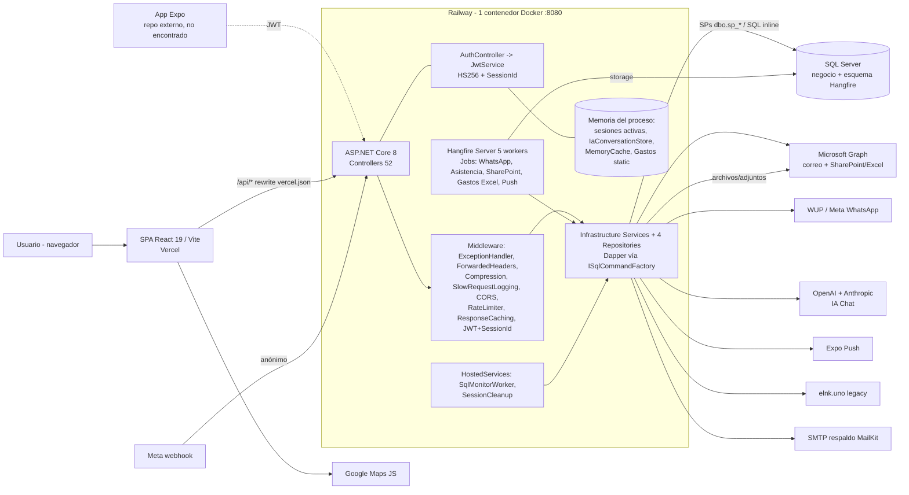

# 03 - Arquitectura actual (Auditoría 2026)

Fecha: 2026-10-14. Solo lectura. Fuente de verdad: código. Convención: **[H]** hecho comprobado, **[I]** inferencia, **[R]** riesgo, **[Rec]** recomendación. Estados: IMPLEMENTADO / PARCIAL / DOCUMENTADO / NO ENCONTRADO / NO VERIFICABLE. Prioridad: P0 (inmediata), P1 (corto plazo), P2 (planificable), P3 (oportunista). No se reproduce ningún secreto.

## 1. Clasificación arquitectónica

**Monolito desplegable en capas (n-tier) con arquitectura "transaction script" sobre stored procedures; no es modular ni hexagonal.**

Fundamento [H]:
- Un único proceso desplegable (`CjERP.Api`, Docker, puerto 8080) aloja API, Hangfire Server y 2 HostedServices (Program.cs líneas 183-251).
- Capas físicas Api -> Application (DTOs/interfaces) -> Infrastructure (Dapper) -> Shared, y `CjERP.Domain` vacío: la separación es de **proyectos**, no de dominio. Los servicios de Infrastructure contienen la lógica de negocio y el acceso a datos; Application no tiene lógica.
- La lógica real reside en SQL Server (SPs `dbo.sp_*`; 149 versionados + ~34 sin versionar según docs) y a veces en controllers (SQL inline: MantenimientoEmpleados/Externos, Contratos, EmpleadoFicha).
- No hay módulos con fronteras: un solo `Program.cs` de 560 líneas registra ~70 servicios (`AddScoped/AddTransient`), una sola base de datos, ningún límite por bounded context. [I] "monolito modular" no aplica: los módulos son carpetas/convenciones de nombre, no assemblies independientes.
- Frontend: SPA monolítica React (224 .tsx), sin micro-frontends, sin store global.

## 2. Diagrama de arquitectura implementada

Flujos [H]: login `POST /api/auth/login` -> `sp_ValidarUsuario` -> JWT con claim `SessionId` + alta en `ActiveUserSessionService`; cada request valida JWT y la sesión en memoria (Program.cs ~427-435); renovación `POST /api/auth/refresh`. Archivos: adjuntos a SharePoint vía `ISharePointCommercialUploadService` (no se almacenan en disco del contenedor). IA: `IaChatController` -> `IaOrchestrator` -> OpenAI (planner) / Anthropic (HTML) -> SP `sp_IA_*`.

## 3. Hallazgos

### ARQ-01 - Sin autorización por rol/política en el backend
- Archivo: `CjERP.Api/Program.cs:446` (`AddAuthorization()` sin políticas); 45 de 52 controllers con `[Authorize]` simple; 0 usos de `Authorize(Roles/Policy)` ([H] grep).
- Evidencia: solo excepciones por código manual (`PagoTesoreriaController`, `MobileMonitorController.Authorized()`).
- Estado: IMPLEMENTADO (como deuda; documentado en TECHNICAL_DEBT C1).
- Impacto: cualquier usuario autenticado invoca aprobaciones, pagos, `KILL` SQL, mantenimiento de empleados; los permisos de `SegPermisoAccion` solo se aplican en FE.
- Riesgo: crítico (escalada de privilegios, fraude interno).
- Prioridad: P0.
- Recomendación: introducir políticas por módulo/acción sobre claims (IdPerfil/IdRol) y validar `SegPermisoAccion` en servidor; empezar por Pagos, OC, Seguridad, SqlMonitor y Mantenimiento.

### ARQ-02 - Sesión activa en memoria del proceso
- Archivo: `CjERP.Infrastructure/Services/ActiveUserSessionService.cs:9` (`ConcurrentDictionary`), registrado Singleton en Program.cs:241; validación en el hook JWT (Program.cs ~427).
- Evidencia: el token solo es válido si `SessionId` existe en el diccionario del proceso.
- Estado: IMPLEMENTADO.
- Impacto: con 2 réplicas, un login atendido por la réplica A produce 401 en la B; un reinicio/redeploy (main despliega solo) cierra la sesión de todos los usuarios; el refresh no sobrevive al reinicio.
- Riesgo: alto para escalado horizontal y disponibilidad percibida; hoy oculto porque hay una sola instancia [I].
- Prioridad: P1.
- Recomendación: persistir sesiones en SQL (tabla con índice por SessionId) o Redis; o eliminar la validación de sesión en servidor y confiar en expiración corta + refresh con revocación en BD.

### ARQ-03 - Estado estático y en memoria de negocio
- Archivo/evidencia [H]: `TesoreriaGastosController.cs:203` `private static readonly List<GastoDto> Gastos`; `InMemoryIaConversationStore` (Singleton, Program.cs:343); `ReporteWhatsappRuntimeMonitor` (Singleton, 314); `AddMemoryCache`/`AddResponseCaching` (Program.cs ~160) con uso de IMemoryCache solo en `PagoTesoreriaController`.
- Estado: IMPLEMENTADO (deuda).
- Impacto: pérdida de datos al reiniciar, resultados distintos por réplica, el `static List` crece sin límite y mezcla datos entre usuarios (C11).
- Riesgo: alto (integridad) en el static; medio en conversaciones IA y monitor.
- Prioridad: P1 (static de gastos), P2 (resto).
- Recomendación: eliminar el static y leer siempre BD; mover conversaciones IA a tabla con TTL; documentar caches como "best effort".

### ARQ-04 - Hangfire y workers embebidos en el proceso web; sin dashboard
- Archivo: `Program.cs:183-198`, `250-251`, `515-557`.
- Evidencia: `AddHangfireServer(WorkerCount=5)` en la misma app; no existe `UseHangfireDashboard` ([H] grep); `PrepareSchemaIfNecessary=true` crea esquema en la BD de negocio; programación al arranque en `Task.Run` con try/catch por job.
- Estado: PARCIAL (jobs sí; observabilidad de jobs NO ENCONTRADA).
- Impacto: un job pesado (PDF por empleado, QuestPDF) compite con las peticiones; no hay forma de ver/reintentar jobs sin SQL manual; con N réplicas hay N servidores (Hangfire lo tolera, pero `RecurringJob.AddOrUpdate` concurrente en cada arranque).
- Riesgo: medio-alto.
- Prioridad: P1.
- Recomendación: montar dashboard protegido por filtro de autorización (rol admin) o exponer estado de jobs por API; separar el host de jobs (mismo código, otro contenedor con flag `RunHangfireServer`); añadir `DisableConcurrentExecution` al job de SharePoint de asistencia y a WhatsApp.

### ARQ-05 - Observabilidad limitada a logs de consola y un health check
- Archivo: `Program.cs:181-182,510`; `Middleware/SlowRequestLoggingMiddleware.cs`; `Health/SqlServerHealthCheck.cs`.
- Evidencia [H]: solo `ILogger` por defecto (sin Serilog/OpenTelemetry/Application Insights: no hay referencias en csproj ni Program.cs); `/health` único (liveness y readiness mezclados, solo chequea SQL; `SELECT 1`, timeout 5 s); `Server-Timing` y log de peticiones lentas (umbral configurable, 1500 ms por defecto); no hay correlation-id ni logging estructurado en JSON; Dockerfile sin HEALTHCHECK.
- Estado: PARCIAL.
- Impacto: diagnóstico de incidentes depende de logs efímeros de Railway; no hay métricas (latencia p95, errores por endpoint, colas Hangfire).
- Riesgo: medio.
- Prioridad: P2.
- Recomendación: OpenTelemetry (trazas+métricas) con exportador a un backend gestionado, correlation-id, health checks separados (`/health/live`, `/health/ready` incluyendo Hangfire y Graph opcional).

### ARQ-06 - Manejo de errores centralizado pero inconsistente en la capa de controllers
- Archivo: `Program.cs:466-483` (handler global, no filtra detalle fuera de Development); patrón `Ok/BadRequest {success,message}` por controller.
- Evidencia [H]: el contrato `{success, message, data}` se construye a mano en cada controller; el FE desenvuelve y rechaza `success:false` (httpClient). `TestConnectionController` devuelve texto plano. Sin `ProblemDetails`, sin filtro de excepciones de dominio, sin mapeo de errores SQL (excepto en Viáticos, con tests `ErrorMappingTests`).
- Estado: PARCIAL.
- Impacto: mensajes de error y códigos HTTP heterogéneos; riesgo de filtrar detalle de SQL en `message` si algún catch devuelve `ex.Message` ([I], no auditado controller por controller).
- Riesgo: medio.
- Prioridad: P2.
- Recomendación: un `ExceptionFilter`/middleware que traduzca excepciones tipadas (validación, no encontrado, conflicto, SQL) al contrato existente; replicar el patrón de Viáticos.

### ARQ-07 - Acoplamiento alto y cohesión baja en servicios/controllers gigantes
- Archivo: `ConciliacionBcpService.cs` 5 584 l., `MantenimientoExternos/EmpleadosController.cs` ~2 700 l., `ContratosController.cs` 2 060 l.; FE `rptasistencia.tsx` 8 657 l. (ver doc 02 §10).
- Evidencia [H]: controllers con `new SqlConnection` (Contratos, EmpleadoFicha, MantenimientoEmpleados/Externos) y 12 servicios de Infrastructure con `new SqlConnection` en vez de `ISqlCommandFactory`; `SegPerfil/SegRol/SegUsuario/AuditoriaCambios` incluidos.
- Estado: IMPLEMENTADO (deuda).
- Impacto: no se puede probar ni cambiar con seguridad; duplicación v1/v2 de pantallas triplica el costo de cambio; la capa Application no protege nada.
- Riesgo: alto (regresiones) y de dependencia de personas clave.
- Prioridad: P1 para extraer SQL de controllers; P2 para partir archivos.
- Recomendación: mover SQL inline a servicios/SPs versionados, dividir por casos de uso (Query/Command), eliminar copias (`rptasistencia copy.tsx`, `pagos_dev.tsx`) y consolidar v1/v2 tras decidir la versión vigente.

### ARQ-08 - Lógica de negocio y esquema fuera del repositorio (SPs y tablas núcleo no versionados)
- Archivo: `CjERP.Backend/Database/**` (160 .sql; 149 SPs únicos); docs DATABASE_MAP (~183 SPs referenciados).
- Evidencia [H]: 0 DDL de las tablas núcleo; sin herramienta de migración; algunos módulos "no ejecutados en BD real" (PV).
- Estado: PARCIAL.
- Impacto: imposible reconstruir el entorno ni revisar cambios de reglas críticas (aprobación, pagos, estados); DR dependiente de backups de BD; entornos (dev/prod) potencialmente divergentes. NO VERIFICABLE si existe un entorno de pruebas aparte.
- Riesgo: alto.
- Prioridad: P1.
- Recomendación: extraer con `sqlpackage`/scripting el esquema actual a un repo versionado (baseline) y adoptar migraciones idempotentes (DbUp) ejecutadas por pipeline.

### ARQ-09 - Sin CI/CD ni gates de calidad; despliegue directo desde main
- Archivo: `.github/workflows/` (vacío); `CjERP.Backend/Dockerfile`; `railpack.json`; `cjerp-frontend/vercel.json`.
- Evidencia [H]: no hay workflows; las ~396 pruebas (249 + 147 xUnit) y las 78 de vitest no se ejecutan automáticamente; Dockerfile sin pruebas (`dotnet test` ausente).
- Estado: NO ENCONTRADO (CI) / IMPLEMENTADO (CD implícito por Railway/Vercel, PV cómo se dispara).
- Impacto: cualquier commit a `main` llega a producción sin build verificado, lint ni tests; con rollback manual.
- Riesgo: alto.
- Prioridad: P0/P1.
- Recomendación: workflow mínimo (dotnet build + test de los 2 proyectos xUnit, `npm ci && npm run build && npm test`) como requisito de PR; rama protegida; entorno staging.

### ARQ-10 - Secretos y artefactos rastreados en git
- Archivo: `CjERP.Backend/CjERP.Api/appsettings.json` (tracked; claves de tipo cadena de conexión, JWT, SMTP, ClientSecret, tokens WhatsApp con valor presente), `cjerp-frontend/.env*`, `CjERP.Backend/tmp/*` (16 archivos), `CjERP.Api.csproj.user`.
- Estado: IMPLEMENTADO (deuda, C6).
- Impacto: compromiso potencial de BD, correo corporativo (Graph), WhatsApp; el historial git conserva los valores aunque se editen.
- Riesgo: crítico.
- Prioridad: P0.
- Recomendación: rotar todas las credenciales, mover a variables de entorno/secret manager, dejar `appsettings.json` solo con placeholders, purgar historial (git filter-repo) y activar escaneo de secretos.

### ARQ-11 - Resiliencia de integraciones: sin reintentos HTTP ni circuit breaker
- Archivo: `Program.cs:236-380` (HttpClients tipados); no hay Polly/Microsoft.Extensions.Http.Resilience en los csproj.
- Evidencia [H]: la tolerancia se hace por try/catch puntuales (correo "no revierte la aprobación"; jobs con `AutomaticRetry`; arranque tolerante); Graph correo primero y SMTP como respaldo (patrón de fallback explícito, pero SMTP da timeout en Railway).
- Estado: PARCIAL.
- Impacto: un fallo transitorio de Graph/WUP/OpenAI se propaga a la petición del usuario o consume los reintentos del job completo.
- Riesgo: medio.
- Prioridad: P2.
- Recomendación: `AddStandardResilienceHandler` en HttpClients externos, timeouts explícitos, idempotencia en envíos (WUP/Meta).

### ARQ-12 - Webhook y endpoints anónimos sin autenticación robusta
- Archivo: `Controllers/WhatsappWebhookController.cs:10` (`[AllowAnonymous]`), `Controllers/TestConnectionController.cs` (sin `[Authorize]`, `[Route("api/[controller]")]`).
- Evidencia [H]: webhook sin validación de firma `X-Hub-Signature-256` (C8); el endpoint de prueba de conexión consulta la BD sin autenticación (solo `CanConnect`, sin datos) y usa el DbContext EF, único uso real de EF en la API.
- Estado: IMPLEMENTADO (deuda).
- Impacto: abuso para disparar generación/envío de PDFs; sondeo de disponibilidad de BD.
- Riesgo: alto (webhook), bajo (test connection).
- Prioridad: P0 (webhook), P3 (test connection: eliminar).
- Recomendación: validar firma HMAC con el app secret de Meta, eliminar `TestConnectionController` y con ello EF Core completo.

### ARQ-13 - Tolerancia a fallos y disponibilidad (punto único de fallo)
- Archivo: `Dockerfile`, `Program.cs`.
- Evidencia [H]: una instancia aparente, una BD (negocio + Hangfire), sin HEALTHCHECK de contenedor, rate limit global de ventana fija configurable (`SqlSettings`) con `QueueLimit=0` (rechaza con 429); `ForwardedHeaders` activado pero sin `KnownProxies` (comportamiento por defecto). Arranque tolerante a fallos de BD para jobs (positivo).
- Estado: PARCIAL. Número real de réplicas y política de reinicio de Railway: NO VERIFICABLE.
- Impacto: caída de la BD = caída total (incluidos jobs); rate limit global puede penalizar a usuarios legítimos tras NAT corporativa [I] (la partición por IP/usuario no está implementada: política única "api").
- Riesgo: medio-alto.
- Prioridad: P2.
- Recomendación: particionar el rate limiter por usuario/IP, health check de contenedor, definir SLO y réplica mínima (tras resolver ARQ-02).

### ARQ-14 - Recuperación ante desastres (DR) no documentada
- Archivo: docs/ (búsqueda de "backup/RPO/RTO/disaster": sin coincidencias relevantes en las docs; solo una mención no relacionada en TECHNICAL_DEBT).
- Estado: NO ENCONTRADO en repo; backups de SQL Server: NO VERIFICABLE.
- Impacto: RPO/RTO desconocidos; esquema y SPs no versionados agravan la reconstrucción (ARQ-08); archivos viven en SharePoint (externalizados, positivo).
- Riesgo: alto.
- Prioridad: P1.
- Recomendación: documentar RPO/RTO, verificar backups full/diff/log y restauración probada trimestralmente, runbook de reconstrucción (BD + variables + DNS Vercel/Railway).

### ARQ-15 - Portabilidad cloud
- Archivo: `Dockerfile`, `railpack.json`, `vercel.json`, `Program.cs` (config por `IConfiguration`).
- Evidencia [H]: backend contenedorizado, config por variables de entorno (positivo), sin almacenamiento local de archivos, sin dependencia de servicios propietarios de Railway en el código; la URL del backend está fija en `vercel.json`; SQL Server fuera de Railway (host no determinable); los jobs requieren SQL Server (Hangfire.SqlServer) y SQL específico de T-SQL (SPs).
- Estado: PARCIAL (portable a cualquier host Docker; no hay IaC).
- Impacto: migrar a Azure/AWS es viable en el compute; el costo está en BD (T-SQL), identidad Graph y DNS; la dependencia de Microsoft Graph favorece Azure.
- Riesgo: bajo-medio.
- Prioridad: P3.
- Recomendación: IaC mínima (Bicep/Terraform), parametrizar el destino del rewrite por entorno, health checks y variables documentadas en un `.env.example` del backend.

### ARQ-16 - Contratos API sin versionado ni documentación operativa
- Archivo: rutas `api/<modulo>/...` en minúsculas; Swagger solo en Development (`Program.cs:490-494`).
- Evidencia [H]: sin `Asp.Versioning`; contratos acoplados a los DTOs usados por FE y por la app móvil externa.
- Estado: NO ENCONTRADO (versionado).
- Impacto: un cambio de contrato rompe app móvil ya instalada (`MobileVersionController` mitiga con control de versión de app, [I]).
- Riesgo: medio.
- Prioridad: P2.
- Recomendación: versionar al menos `/api/mobile/*`; publicar OpenAPI generado en CI.

### ARQ-17 - Persistencia: Dapper + SPs con conexión por operación; EF Core muerto
- Archivo: `Infrastructure/Persistence/Sql/SqlCommandFactory.cs` (Singleton; timeouts configurables `ConnectTimeoutSeconds`, `DefaultCommandTimeoutSeconds`); `Persistence/Context/CjERPDbContext.cs` (sin DbSets).
- Evidencia [H]: patrón uniforme en la mayoría de servicios (positivo, simple y rápido); transacciones ausentes en varios flujos ("MAX(Id)+1", docs ALTO); sin unidad de trabajo.
- Estado: IMPLEMENTADO.
- Impacto: consistencia dependiente de cada SP; paquetes EF 8.0.11 aumentan superficie de ataque sin valor.
- Riesgo: medio.
- Prioridad: P2.
- Recomendación: retirar EF Core; estandarizar `ISqlCommandFactory` (12 sitios con `new SqlConnection`); transacciones explícitas en operaciones multi-SP.

### ARQ-18 - Frontend: seguridad de sesión en cliente y monolito de pantallas
- Archivo: `cjerp-frontend/src/api/httpClient.ts`, `utils/authStorage.ts` (token en `localStorage["authUser"]`), `app/session/SessionManager.tsx`.
- Evidencia: token en localStorage (expuesto a XSS) [H, según AGENTS.md; no se releyó el código en esta pasada: NO VERIFICABLE al detalle]; 224 .tsx con 138 rutas lazy (positivo para carga inicial).
- Estado: IMPLEMENTADO.
- Impacto: XSS = robo de token de 30 min.
- Riesgo: medio.
- Prioridad: P2.
- Recomendación: CSP estricta en Vercel (headers en `vercel.json`, hoy ausentes), reducir superficie de `dangerouslySetInnerHTML` (IA Chat genera HTML, [I] verificar sanitización).

## 4. Cohesión y acoplamiento (resumen)

| Eje | Valoración | Evidencia |
|---|---|---|
| Acoplamiento Api<->Infrastructure | Alto: Api referencia Infrastructure directamente y los controllers instancian SQL | ARQ-07 |
| Acoplamiento a BD | Muy alto: reglas en SPs no versionados | ARQ-08 |
| Cohesión de capa Application | Baja (solo DTOs/interfaces) | CjERP.Domain vacío |
| Cohesión módulo IA Chat | Buena: namespaces AI/Conversation/Orchestration/Export/Tools/Security y 249 tests | tests Ia |
| Cohesión módulo Viáticos | Buena: controller + filtro (`ViaticoApiFilter`), servicios, 57 scripts, 147 tests, FE con 78 tests | referencia interna para refactor |
| Cohesión FE | Baja en pantallas de 4-8 mil líneas; buena en `components/base` | doc 02 §10 |
| Dependencias cíclicas | No se evidenciaron en proyectos .NET (grafo acíclico Api->Infra->App->Domain/Shared) [H] | csproj |

## 5. ¿Aportarían valor los microservicios?

[I] **No como migración general.** Equipo pequeño, una BD compartida con reglas en SPs, ausencia de CI, de pruebas y de observabilidad: los microservicios multiplicarían despliegues y fallos distribuidos sin resolver la deuda real (ARQ-01/08/09). Valor limitado y localizado:
1. **Worker de jobs separado** (mismo código/imagen, otro proceso; ARQ-04): aísla carga de PDFs/WhatsApp/SharePoint de la API. Es la primera y más barata separación.
2. **IA Chat** como servicio aislado, solo si crece el uso, por coste, tiempos largos y claves de terceros; hoy ya está bien acotado por namespace y tests.
3. **Backend móvil** versionado y con escalado independiente si la flota lo exige.
Alternativa recomendada: **monolito modular real** (assemblies por módulo: Tesorería, RRHH, Arrendamientos, IA, Mobile, Viáticos), políticas de autorización por módulo y esquema SQL versionado; evaluar extracción posterior solo con métricas (ARQ-05) que lo justifiquen.

## 6. Plan de prioridades (síntesis)

| Prioridad | IDs |
|---|---|
| P0 | ARQ-01, ARQ-10, ARQ-12 (webhook), ARQ-09 (CI mínimo) |
| P1 | ARQ-02, ARQ-03 (static), ARQ-04, ARQ-07 (SQL en controllers), ARQ-08, ARQ-14 |
| P2 | ARQ-05, ARQ-06, ARQ-11, ARQ-13, ARQ-16, ARQ-17, ARQ-18, ARQ-03 (resto) |
| P3 | ARQ-12 (TestConnection), ARQ-15 |

## 7. Alcance y límites de esta auditoría
- Revisado: Program.cs (secciones de servicios, middleware, jobs y auth), listado y atributos de autorización de controllers, Jobs, health, middleware, ActiveUserSessionService, SqlCommandFactory (timeouts), csproj, Dockerfile, vercel.json, .github, conteos.
- No verificado: comportamiento real en Railway (réplicas, variables), versión/edición de SQL Server, backups, contenido interno de la mayoría de servicios, sanitización de HTML en FE, correcta aplicación de `PrepareSchemaIfNecessary` en producción, valor real de `RateLimitPermitLimit`. Se marcan NO VERIFICABLE o PV donde corresponde.
- Los puntos que dependen de docs (C1-C12, SPs no versionados, módulos "no ejecutados en BD") son DOCUMENTADO salvo que arriba se indique verificación en código.
