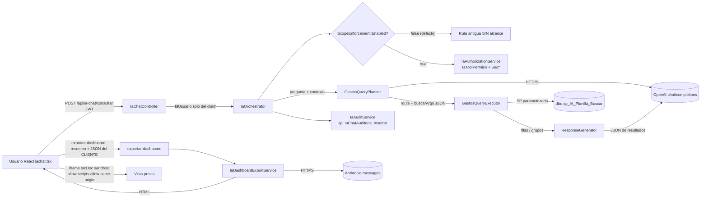
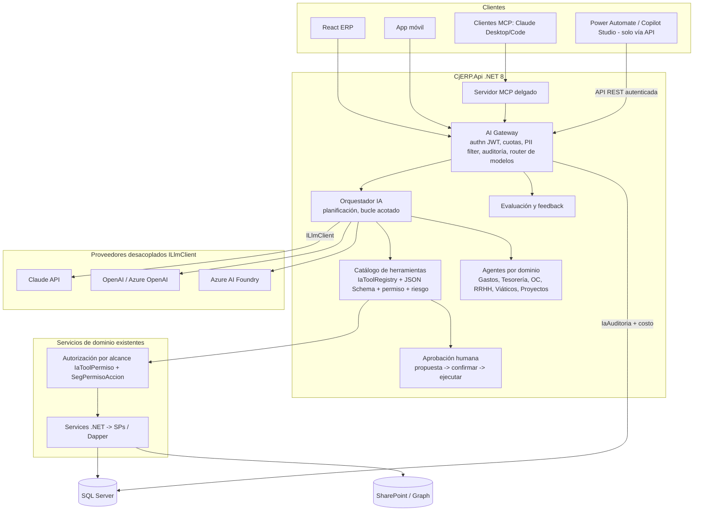

# 06 - Auditoría de IA y Agentes (CJ ERP Web)

> Auditoría de SOLO LECTURA. Fecha de análisis: 2026-10-14. Repo: `Cj-Erp-Web/` (árbol de trabajo con cambios sin commit; HEAD `d9765b8`).
> Convención: **[HECHO]** = comprobado leyendo código/scripts; **[INFERENCIA]** = deducción razonable; **[RIESGO]**; **[RECOMENDACIÓN]**; **PV** = pendiente de validación (requiere BD/Railway/Azure, no verificable desde el repo).
> No se muestran secretos. No se ejecutó nada contra BD, Railway ni proveedores LLM.

---

## 1. Resumen ejecutivo

1. **Clasificación real de la IA del ERP: "chat tradicional con planificador LLM y una única herramienta fija"** (un solo tool: `buscar_planilla` -> SP `sp_IA_Planilla_Buscar`). No es agente, no es multiagente, no es RAG, no es copiloto transaccional. Tiene un 2.º uso (Anthropic) solo para generar un dashboard HTML.
2. **El diseño "AI Copilot" (docs `AI_COPILOT_*`) está implementado solo en su Fase 1 (refactor) y parcialmente en la Fase 2 (autorización por alcance), y esa parte está APAGADA por defecto** (`IaChat:ScopeEnforcement:Enabled = false`) y con los scripts SQL "preparados, no ejecutados". Fases 3-7 (ToolRegistry, conversaciones persistentes, feedback, RAG, Orden de Compra) son **aspiracionales: no existe código**.
3. **Hallazgo más grave: con el interruptor apagado, el chat consulta gastos SIN alcance por usuario** (cualquier cuenta con el menú "Chat IA" ve datos globales de Planilla; el control es solo de menú/FE). Además el iframe que previsualiza el dashboard generado por LLM usa `sandbox="allow-scripts allow-same-origin"` sobre `srcDoc`, lo que permite que un HTML malicioso/inyectado lea `localStorage["authUser"]` (JWT).
4. **No hay control de costos/tokens** (no se captura `usage`), ni evaluación de calidad, ni persistencia de conversaciones, ni auditoría confiable (el SP de auditoría figuraba como inexistente en `JC_Db` y el servicio traga el error).
5. **No existe** MCP, RAG/embeddings, agentes, Telegram, Power Automate/Power Apps en el repo. Voz = Web Speech API del navegador (no es un servicio propio).
6. **La base técnica es aprovechable**: proveedores detrás de interfaces, LLM que NO genera SQL (solo argumentos JSON validados hacia un SP parametrizado), conversación con dueño por usuario, JWT como identidad, suite de pruebas `Tests.Ia`. La arquitectura propuesta (sección 8) la extiende sin reescribir.

---

## 2. Estado real: implementado vs documentado vs aspiracional

| Capacidad | Estado | Evidencia |
|---|---|---|
| Chat IA de gastos (`POST /api/ia-chat/consultar`) | **IMPLEMENTADO, en uso** (menú Chat IA para perfiles-rol 26/27 según scripts; uso real PV) | `IaChatController.cs`, `AI/Orchestration/IaOrchestrator.cs` (2 002 líneas) |
| Planner OpenAI (JSON) | IMPLEMENTADO | `AI/Planning/GastosQueryPlanner.cs`, `AI/Providers/OpenAiChatProvider.cs` (`/v1/chat/completions`, `temperature=0`, `response_format=json_object`) |
| Respuesta narrativa OpenAI | IMPLEMENTADO | `AI/Orchestration/ResponseGenerator.cs` |
| Dashboard HTML con Anthropic | IMPLEMENTADO (`POST /api/ia-chat/exportar-dashboard`) | `AI/Export/IaDashboardExportService.cs`, `AI/Providers/AnthropicMessagesProvider.cs` (`tools: []`) |
| Herramienta SQL (SP) | IMPLEMENTADO (1 tool) | `AI/Tools/Gastos/GastosQueryExecutor.cs` -> `dbo.sp_IA_Planilla_Buscar` (detalle y modo RESUMEN) |
| Autorización por alcance (Propio/Equipo/Total, totales globales, campos ocultos) | **CÓDIGO LISTO, DESACTIVADO** | `IaAuthorizationService`, `IaPermissionStore`, `IaEmployeeDirectory`, `IaScopeEnforcementOptions.Enabled=false` (por defecto); scripts `08`,`09`,`02`,`10` **no ejecutados** (PV) |
| Auditoría `sp_IaChatAuditoria_Insertar` | CÓDIGO LISTO; **SP/tabla ausentes en `JC_Db` al 2026-10-03** según `AI_COPILOT_FASE2_INTEGRACION_DEV.md` §7 (script `01` pendiente de decisión) | `AI/Audit/IaAuditService.cs` (catch -> solo `LogWarning`) |
| Conversación (memoria) | IMPLEMENTADO en memoria de proceso | `AI/Conversation/IaConversationStore.cs` registrado Singleton `InMemoryIaConversationStore` |
| Otros usos LLM | IMPLEMENTADOS | `ConciliacionBcpService` (OpenAI, exportación de extractos), `SqlMonitorService.AnalizarQueryAsync` (OpenAI) |
| FE chat | IMPLEMENTADO | `features/reportes/administrativo/iachat.tsx` (5 020 líneas) + `iachat/hooks/useSpeechDictation.ts`, `useSpeechReader.ts` |
| `features/reportes/administrativo/claudeia.tsx` | Formulario con `buildPrompt` en cliente; **no llama a LLM** (sin fetch a proveedor, comprobado por grep) - PV de su uso (probablemente genera un prompt para copiar a Claude) | `claudeia.tsx` |
| `features/cj-intelligence/**` | **ROTO** | `aiService.ts`/`knowledgeService.ts` llaman `/ai/status`, `/ai/chat`, `/ai/conversations`, `/ai/knowledge/*`; **no existe controller `api/ai`** (grep); rutas igual montadas en `AppRouter.tsx:283-284` |
| AI Copilot Fase 3 `IaToolRegistry`, Fase 4 `IaConversationService`, Fase 5 feedback/tokens, Fase 6 RAG, Fase 7 OC | **ASPIRACIONAL** | grep: `IaToolRegistry`, `IaConversationService`, `IaSemanticCatalog` sin ocurrencias en código; solo `IaToolPermiso` aparece (tienda de permisos) |
| Viáticos con IA | **NO IMPLEMENTADO** (módulo Viáticos fases 1-3 en repo, sin llamadas LLM) | `Services/Viaticos/*` sin referencias a proveedores; solo README menciona "no modificar IA Chat" |
| MCP | **NO ENCONTRADO** | grep en BE/FE |
| RAG / embeddings / vector store | **NO ENCONTRADO** (solo diseñado en `AI_COPILOT_DESIGN.md` §9, Fase 6 "Pendiente") | |
| Voz | Parcial, solo navegador (Web Speech API: dictado y lectura) | `useSpeechDictation.ts`, `useSpeechReader.ts` |
| Agentes / multiagente | **NO ENCONTRADO** | |

### 2.1 Clasificación

| Categoría | ¿Aplica? | Justificación |
|---|---|---|
| Chat tradicional (LLM + prompt) | Sí, base | Planner + narrador |
| **IA con herramientas** | **Sí, mínimo** | 1 herramienta fija (SP); el LLM no elige entre herramientas (route solo `buscar_planilla` o `conversation`); no hay function-calling nativo (Anthropic recibe `tools: []`) |
| RAG | No | Sin índice documental ni embeddings |
| Agente (bucle plan-actúa-observa) | No | Una pasada: planner -> SP -> narrador |
| Multiagente | No | |
| Copiloto (acciones sobre el ERP con aprobación humana) | No | Solo lectura; ninguna escritura |

**[HECHO]** La parte "IA con herramientas" tiene además mucha lógica determinista: `BuscarPlanillaQuestionHeuristics.cs` (901 líneas), `IaConversationFollowUpResolver.cs` (662), `GastosQueryPlanner.NormalizeOpenAiPlannerDecision` que puede **forzar** la ruta por heurística. Es un híbrido regla+LLM, lo cual reduce alucinación pero encarece el mantenimiento.

---

## 3. Flujo real verificado

---

## 4. Hallazgos IA-nn

Prioridad: P0 (inmediata), P1 (1-2 sprints), P2 (planificable), P3 (mejora).

### IA-01 - Alcance de datos no aplicado (ruta antigua activa)
- **Archivo/método:** `IaOrchestrator.ConsultarAsync` (`_enforceScope`), `IaScopeEnforcementOptions.cs`, `Program.cs:359-363`, `GastosQueryExecutor.BuildParameters(args, scope=null)`.
- **Evidencia [HECHO]:** `Enabled` por defecto `false`; con `false` el SP se llama sin `@AlcanceNivel/@AlcanceCampos/@AlcanceEmpleados/@VerTotalesGlobales`; el SP vigente (18 parámetros según `04`) no filtra por usuario. Los claims IdCargo/IdPerfil del JWT no se usan. El comentario de cabecera de `IaAuthorizationService`/`IaPermissionStore` ("no registrado en DI") está desactualizado: **sí están registrados** (`Program.cs:356-358`) pero no se invocan.
- **Estado:** Implementado el mecanismo; **no activo**. Scripts `08/09/02/10` no ejecutados (PV; confirmar en BD si `IaToolPermiso` existe y si Railway tiene `IaChat__ScopeEnforcement__Enabled`).
- **Impacto:** Cualquier usuario con acceso al menú ve gastos, montos, responsables y solicitantes de toda la empresa; también por llamada directa a la API (la API solo exige JWT).
- **Riesgo:** Alto (confidencialidad financiera/personal). **Prioridad: P0.**
- **Recomendación:** Ejecutar el procedimiento escalonado E1-E6 de `AI_COPILOT_FASE2_INTEGRACION_DEV.md` (respaldo `COPY_ONLY`, 08 -> 09 -> 02 -> activar -> aceptación F-01..F-19 -> 10). Mientras tanto restringir el menú Chat IA al conjunto mínimo (ya limitado a perfiles-rol 26/27 según `10`). Retirar la rama heredada al activar (como indica el propio código).

### IA-02 - Dashboard HTML de LLM renderizado con `allow-scripts allow-same-origin`
- **Archivo:** `iachat.tsx:2809-2813` (`<iframe srcDoc={reportPreviewHtml} sandbox="allow-scripts allow-same-origin">`); `exportDashboardHtmlAsPdf` también usa `srcdoc` (l. 903).
- **Evidencia [HECHO]:** el HTML lo produce Anthropic a partir de `contextualSummary` y `structuredDataJson` que **el cliente envía** (`IaChatDashboardExportRequestDto`), el backend no revalida contra los datos reales. El prompt exige cargar Chart.js desde CDN (script externo).
- **Impacto [INFERENCIA técnica]:** un `srcdoc` con `allow-same-origin` hereda el origen de la app; el script embebido puede leer `localStorage["authUser"]` (JWT) y llamar a la API. Vector: usuario malicioso o inyección indirecta (texto libre de Planilla "Detalle", nombres, etc. dentro del JSON) que haga que el modelo emita `<script>` hostil. Además la integridad de cifras no está garantizada (el JSON lo aporta el cliente).
- **Riesgo:** Alto. **P0/P1.**
- **Recomendación:** quitar `allow-same-origin` (dejar `allow-scripts` solo si Chart.js se sirve embebido, o mejor renderizar los gráficos con `recharts` desde datos y no HTML libre); sanitizar HTML en servidor (allow-list); CSP; que el backend reconstruya `structuredDataJson` desde el `conversationId` (memoria del servidor) en vez de aceptarlo del cliente.

### IA-03 - Auditoría ineficaz o no verificable
- **Archivo:** `AI/Audit/IaAuditService.cs`; `Database/IaChat/01_IaChatAuditoria.sql`; doc `AI_COPILOT_FASE2_INTEGRACION_DEV.md` §7.
- **Evidencia [HECHO]:** `RegistrarAsync` captura toda excepción y solo hace `LogWarning`; el doc indica que `sp_IaChatAuditoria_Insertar` **no existía en `JC_Db`** (2026-10-03). La tabla guarda pregunta completa y parámetros, **no** guarda respuesta, modelo, proveedor, tokens, costo, `conversationId` ni versión de prompt. Hay un `TEMPORAL` que devuelve `spParameters` al FE (`IaOrchestrator.WithConversationId`) y lo imprime en consola del navegador.
- **Estado:** Código listo; despliegue PV.
- **Impacto:** Sin trazabilidad de quién preguntó qué ni qué datos salieron; no se puede investigar fuga ni sobreuso.
- **Riesgo:** Alto. **P0** (verificar con script `11`/`12` C08).
- **Recomendación:** ejecutar `01`, dar `EXECUTE` al usuario de la API, alertar si falla la auditoría (métrica), ampliar con campos de Fase 5 (proveedor, modelo, tokens, hash de prompt, `conversationId`, filas devueltas, filtro de alcance aplicado). Quitar `spParameters` del response en producción.

### IA-04 - Sin control de costos ni de uso
- **Archivo:** `OpenAiChatProvider`, `AnthropicMessagesProvider`, `Program.cs:171-183` (rate limiter global).
- **Evidencia [HECHO]:** solo `MaxTokens` (por defecto 1 500); no se lee `usage` de ninguna respuesta; sin cuota por usuario/día; sin reintentos con backoff ni circuit breaker en providers; timeout HttpClient 90 s (OpenAI). `fetchAllPages` puede traer hasta `MaxLocalAggregationRows = 4 000` filas para agregación local (no necesariamente enviadas al LLM; PV qué parte del payload se envía).
- **Impacto:** costos impredecibles; un usuario puede disparar consultas ilimitadas (el rate limit es global por API, no por cuenta).
- **Riesgo:** Medio. **P1.**
- **Recomendación:** capturar `usage` y guardar costo estimado por llamada; presupuesto diario por usuario y global; límite de tamaño de payload al LLM (enviar agregados, no filas); Polly con reintentos 429/5xx.

### IA-05 - Datos enviados a proveedores externos
- **Archivo:** `ResponseGenerator.GenerateOpenAiFinalAnswerAsync` (payload JSON completo), `IaDashboardExportService` (resumen + `structuredDataJson`), `GastosQueryPlanner` (pregunta + contexto de conversación), `ConciliacionBcpService` (muestras de extracto, `MaxSampleRows=8`), `SqlMonitorService.BuildAnalysisPrompt` (texto de queries).
- **Evidencia [HECHO]:** al LLM viajan: la pregunta del usuario, historial de conversación y el **resultado estructurado** de Planilla (campos del SP: site, cliente, proyecto, OT, responsable, solicitante, estado, montos, moneda, fechas; la lista exacta de columnas depende del SP - PV, ver `IaGlobalColumns.cs` y script `16/17`). Con alcance activo, 15 columnas "globales" se retiran de las filas (`IaGlobalColumns.StripFromRows`). El binario de adjuntos (imagen/PDF) **no se observa** transmitido (`OpenAiChatMessage.Content` es texto; el adjunto solo cambia instrucciones) - **[INFERENCIA]**, validar. SQL Monitor puede enviar texto SQL con literales (posibles datos).
- **Datos personales/financieros:** nombres de empleados (responsable/solicitante), montos, clientes. Sin DLP/minimización/pseudonimización. Sin contrato/DPA documentado con los proveedores (PV legal; la Ley 29733 de Perú aplica a datos personales y flujo transfronterizo).
- **Riesgo:** Medio-Alto. **P1.**
- **Recomendación:** minimización por herramienta (el narrador recibe agregados y top-N, no filas con nombres), pseudonimizar personas ("Solicitante A") y re-sustituir en el servidor, registro de qué campos salen, evaluar zero-retention / endpoint empresarial (sección 9).

### IA-06 - Prompt injection y guardrails débiles
- **Archivo:** `AI/Security/IaPromptGuardrails.cs`.
- **Evidencia [HECHO]:** el único guardrail es una regex de tokens en inglés (`delete|drop|alter|truncate|insert|update|merge|exec|execute`) sobre la pregunta: da falsos positivos ("actualizar" no, pero "update" sí) y no cubre inyección real. **Mitigación estructural positiva:** el LLM no escribe SQL; solo devuelve `route/responseType/buscarArgs` que se parsean (`BuscarPlanillaArgsParser`) y entran como parámetros de un SP -> no hay SQL injection vía LLM. La inyección indirecta (texto libre en campos de Planilla dentro del JSON enviado al narrador) solo puede alterar el texto de respuesta, no ejecutar acciones (no hay herramientas de escritura). Los prompts instruyen "No inventes datos".
- **Riesgo:** Medio (por diseño de solo lectura); sube a Alto si se añaden herramientas de escritura sin rediseñar. **P2.**
- **Recomendación:** delimitar datos como no confiables en el prompt (`<datos>...`), validar salida contra esquema (ya JSON), listas de permitidos de filtros, detección de inyección en campos libres antes de enviar, pruebas adversariales en la suite de evaluación (sección 10).

### IA-07 - Permisos: el chat no respeta IdCargo/perfil hoy
- **Evidencia [HECHO]:** el controller toma `IdUsuario` del claim (correcto: no del body). Con enforcement activo el alcance se resuelve **en servidor** por `IdUsuario` -> `SegUsuarioPerfilRol` activo -> `IaToolPermiso` (no usa los claims IdPerfil/IdRol del JWT: decisión documentada porque el login puede devolver filas inactivas). Niveles PROPIO/EQUIPO(subordinados directos por `EmpleadoCjDetalle.IdResponsableCj`)/TOTAL + `PermiteTotalesGlobales`; fail-closed; unión de concesiones al nivel más amplio; memoria de conversación invalidada si cambia el alcance (`MatchesAuthorizedScope`). Matriz aprobada 2026-10-03 (11 perfil-rol) en script `09`.
- **Limitación [HECHO]:** el alcance es por campo `ResponsableOSolicitante` (Planilla) - no cubre filtros por cliente/proyecto/sede; **EQUIPO = solo subordinados directos**. Sin pantalla de mantenimiento de permisos.
- **Estado:** diseño sólido, **no activo** (ver IA-01).
- **Prioridad:** P0 (activación) / P2 (pantalla de permisos).

### IA-08 - Estado de conversación en memoria de proceso
- **Archivo:** `Program.cs:343` (`AddSingleton<IIaConversationStore, InMemoryIaConversationStore>`), `IaConversationStore.cs`.
- **Evidencia [HECHO]:** el ID de conversación lo genera el backend y se valida el dueño (bien). Se pierde en cada reinicio/deploy y no escala a >1 instancia (mismo problema que `ActiveUserSessionService`). Contiene filas de resultados (datos) en RAM.
- **Riesgo:** Medio. **P2.** **Recomendación:** persistir en SQL (`IaConversacion/IaMensaje` de la Fase 4) con retención y cifrado, caché L1 con `IMemoryCache`.

### IA-09 - `features/cj-intelligence` roto y rutas huérfanas
- **Evidencia [HECHO]:** FE llama `/ai/*`; backend sin controller. `AppRouter` monta `/cj-intelligence` y `/cj-intelligence/knowledge` con "memorias" (approve/observe/reject) y catálogo: es el esqueleto de una versión anterior/futura del copiloto.
- **Riesgo:** Bajo (404) pero confunde y expone superficie. **P3.** **Recomendación:** retirar del router o marcarlo `Deprecated`; reutilizar sus tipos si se implementa feedback/knowledge.

### IA-10 - Documentación desalineada con el código
- **Evidencia [HECHO]:** `AGENTS.md` e `INTEGRATIONS.md` citan `IaChatService`/`SendMessageAsync`; el código real es `IaOrchestrator` + `AI/*` (IaChatService fue eliminado, Fase 1 cerrada 2026-10-02). `CjERP.Backend/Docs/IAChat.md` no describe autorización, auditoría, ni `IaChat:ScopeEnforcement`. `IaAuthorizationService` conserva un encabezado "no registrado en DI" falso.
- **Prioridad:** P2 (regla del repo: manda el código; actualizar docs).

### IA-11 - Acoplamiento a proveedor a medias
- **Evidencia [HECHO]:** existen interfaces `IOpenAiChatProvider` y `IAnthropicMessagesProvider` (buen punto de extensión), pero con tipos propios del proveedor (`OpenAiChatMessage`, `AnthropicMessageRequest`) y el planner/narrador dependen de `IOpenAiChatProvider`. No hay `ILlmClient` común, ni enrutamiento por tarea/costo, ni fallback entre proveedores. Modelo y claves por variables de entorno (bien). Endpoints fijos (`api.openai.com`, `api.anthropic.com`) en código.
- **Prioridad:** P2. **Recomendación:** introducir `ILlmClient` (mensajes, herramientas, esquema de salida, usage) con adaptadores OpenAI/Anthropic/Azure OpenAI y `ModelRouter` por tarea.

### IA-12 - Otros usos de LLM sin gobierno común
- **Evidencia [HECHO]:** `ConciliacionBcpService` (OpenAI, HttpClient propio `BaseAddress=https://api.openai.com`, timeout 120 s) y `SqlMonitorService` (OpenAI directo con `Authorization: Bearer`) **no pasan** por los providers/auditoría del chat. Sin registro de costo/uso/datos enviados.
- **Riesgo:** Medio. **P2.** **Recomendación:** migrarlos al futuro AI Gateway.

### IA-13 - Secretos de proveedores IA con rotación pendiente
- **Evidencia [HECHO]:** `Viaticos_Fase5_Validacion_E2E.md` indica rotación pendiente de OpenAI/Anthropic y otros secretos expuestos como requisito previo a pase productivo; `TECHNICAL_DEBT.md` C6. No se verificaron valores.
- **Riesgo:** Alto. **P0.** **Recomendación:** rotar, claves por entorno con límite de gasto en el panel del proveedor, secretos en Key Vault/variables Railway.

### IA-14 - Adjuntos sin hardening
- **Archivo:** `AI/Attachments/IaAttachmentValidator.cs`.
- **Evidencia [HECHO]:** acepta `image/*` y PDF en base64 sin límite de tamaño, magic bytes ni cantidad (documentado como tarea de hardening aparte D-6). Un cuerpo grande puede agotar memoria/costo.
- **Prioridad:** P1.

### IA-15 - Voz solo en navegador
- **Evidencia [HECHO]:** dictado y lectura vía Web Speech API (`SpeechRecognition`, `speechSynthesis`); sin STT/TTS propio ni costo de proveedor. **[INFERENCIA]:** en Chrome el reconocimiento de voz envía audio al servicio del navegador (proveedor del navegador), lo cual no pasa por la auditoría del ERP.
- **Prioridad:** P3. Documentar en el aviso de privacidad.

### IA-16 - Calidad no medible
- **Evidencia [HECHO]:** existe `Tests/CjERP.Backend.Tests.Ia` (proveedores falsos, contratos de scripts SQL, orquestador, planner con `FakeOpenAiChatProvider`) - útil para regresión determinista; **no hay evaluación con modelo real ni conjunto dorado de preguntas**, ni feedback del usuario.
- **Prioridad:** P2.

### IA-17 - Viáticos IA / AI Copilot "para otros módulos" no existen
- **Evidencia [HECHO]:** no hay integración IA en Viáticos ni OC. Plan Fase 7 (OC) sin código.
- **Prioridad:** informativa. Ver catálogo `13_Catalogo_Oportunidades_IA.md`.

---

## 5. Prompts (resumen verificado)

| Prompt | Ubicación | Observación |
|---|---|---|
| Planner (JSON) | `GastosQueryPlanner.DecideAsync` | Reglas en español: etiquetas explícitas, PAGADO por defecto, fechas ISO; salida `route/responseType/answer/buscarArgs`. Embebido en C# (no versionado ni externalizado). |
| Narrador | `ResponseGenerator` | Obliga a no inventar, separar por moneda, honrar `unavailableFields` (no estimar campos ocultos). Buen control de "no disponible != 0". |
| Dashboard | `IaDashboardExportService` | Pide HTML completo con Chart.js por CDN; "prioriza el JSON estructurado". Sin sanitización de salida (ver IA-02). |

**[RECOMENDACIÓN]** externalizar prompts con versión (`PromptVersion` en auditoría), pruebas de regresión por versión.

---

## 6. Gobierno y seguridad de IA (estado y brecha)

| Dominio | Estado actual | Brecha / acción |
|---|---|---|
| Identidad | JWT -> `IdUsuario`, sin identidad en body | Correcto |
| Autorización | Código listo, apagado | Activar (IA-01) |
| Minimización de datos | No | IA-05 |
| Auditoría | Código listo, SP PV | IA-03 |
| Costos | No | IA-04 |
| Retención de conversaciones | RAM | IA-08 |
| Evaluación | Solo pruebas unitarias | IA-16 |
| Gestión de proveedores | Claves en env; sin DPA/ZDR documentado | Legal/TI |
| Respuestas generadas | HTML sin sanitizar | IA-02 |
| Derechos de datos personales (Ley 29733) | No evaluado | PV Legal |
| Aprobación humana | N/A (solo lectura) | Obligatoria al introducir escrituras |

Principios propuestos: (1) **mínimo privilegio heredado del usuario**; (2) **el LLM propone, el ERP decide** (todo lo ejecutable pasa por la API/servicio de dominio con la misma autorización que la UI); (3) **sin SQL libre**; (4) **escrituras solo con confirmación humana explícita y token de un solo uso**; (5) **toda llamada auditada** (quién, qué herramienta, qué parámetros, qué datos salieron, costo); (6) **desacople de proveedor**; (7) **fallo seguro** (denegar ante duda).

---

## 7. MCP, RAG, agentes: ¿qué corresponde?

- **MCP [NO ENCONTRADO]:** adecuado como **interfaz de herramientas** hacia clientes de IA (Claude Desktop/Code, agentes) que necesiten consultar el ERP. **No sustituye** a las APIs: un servidor MCP debe ser una capa delgada que invoque las mismas APIs/servicios del ERP con la identidad del usuario (OAuth/JWT delegado), exponer solo herramientas de lectura al inicio y registrar auditoría. Para el chat interno del ERP no hace falta MCP: el orquestador .NET llama directo a los servicios.
- **RAG [NO ENCONTRADO]:** útil para soporte funcional (documentación `docs/*.md`, manuales, políticas) y para búsqueda semántica en SharePoint; **no** para datos transaccionales (se consultan por herramientas/SPs).
- **Agentes:** solo tras tener ToolRegistry + permisos + auditoría + aprobación humana. Empezar con agentes **de lectura/análisis** por dominio.

---

## 8. Arquitectura propuesta

### 8.1 Vista lógica

### 8.2 Componentes

| Componente | Responsabilidad | Reutiliza |
|---|---|---|
| **AI Gateway** | Único punto de salida a LLM: JWT, cuota/usuario, límites de tamaño, enmascarado de PII, registro de `usage`/costo, reintentos, circuit breaker, selección de modelo por tarea, kill-switch | `IOpenAiChatProvider`/`IAnthropicMessagesProvider` como adaptadores; `IaAuditService` |
| **Orquestador** | Bucle acotado (máx. N pasos), contexto de conversación persistente, resolución de herramienta | `IaOrchestrator`, `GastosQueryPlanner` (pasa a ser "plan por herramienta") |
| **Catálogo de herramientas** | Cada herramienta = contrato (nombre, JSON Schema, `ScopeLevel`, `Riesgo` lectura/escritura, `RequiereAprobacion`, límite de filas, campos exportables al LLM) sobre un **servicio de dominio**, jamás SQL libre | Fase 3 del plan (`IaToolRegistry`), `IaToolPermiso` ya diseñada |
| **Agentes por dominio** | Prompt + subconjunto de herramientas + políticas; arrancan en solo lectura | Dominios de `docs/MODULES.md` |
| **Permisos heredados** | La herramienta recibe `IaResolvedScope` derivado del `IdUsuario` del JWT (nunca del LLM ni del body); mismo permiso que la UI | `IaAuthorizationService` |
| **Aprobación humana** | Toda escritura: la IA genera una **propuesta** (diff) -> el usuario confirma en UI -> la API ejecuta con la acción de negocio normal y deja auditoría | Estados existentes (pago, aprobaciones) |
| **Auditoría** | Quién, herramienta, parámetros, filas, campos enviados al LLM, modelo, tokens, costo, `PromptVersion`, resultado | Ampliar `IaChatAuditoria` (Fase 5) |
| **Evaluación** | Conjunto dorado, regresión por versión de prompt/modelo, métricas de exactitud y rechazo, red-team de inyección | `Tests.Ia` |
| **Servidor MCP** | Exposición de herramientas de **lectura** a clientes externos con la misma autorización y auditoría | Catálogo de herramientas |

### 8.3 Claude vs OpenAI vs Azure AI Foundry

Sin precios (no se inventan). Criterios para decidir; **la decisión debe tomarse tras una prueba con el conjunto dorado propio**.

| Criterio | Claude (API Anthropic) | OpenAI (API) | Azure AI Foundry (Azure OpenAI y otros) |
|---|---|---|---|
| Ya integrado en el ERP | Sí (dashboard HTML) | Sí (planner/narrador/conciliación/SQL monitor) | No |
| Uso de herramientas/JSON estructurado | Soportado (tool use) | Soportado | Soportado (según modelo desplegado) |
| Residencia/contratación empresarial en Azure, Entra ID, redes privadas | No nativo | No nativo | **Sí (fortaleza)**; alinea con ecosistema M365/Azure |
| Facturación y gobierno centralizado | Cuenta Anthropic | Cuenta OpenAI | Suscripción Azure (cuotas, políticas, Defender) |
| Riesgo de dependencia | Proveedor único si se centraliza | idem | Reduce lock-in porque expone varios modelos; sigue habiendo dependencia de Azure |
| Acción recomendada | Mantener para análisis/redacción larga y generación de documentos | Mantener mientras no se migre | Evaluar como destino del AI Gateway si CJ ya opera Azure/M365 |

**[RECOMENDACIÓN]** no casarse con un proveedor: `ILlmClient` + `ModelRouter` y comparar con el mismo conjunto dorado (exactitud de argumentos, latencia, costo por consulta).

### 8.4 Suscripción Claude vs API de producción (aclaración)

- La **suscripción de Claude** (Pro/Team/Enterprise en claude.ai / Claude Code / Desktop) es un **producto de usuario** (chat, skills, conectores, agentes de escritorio). Sirve para trabajo individual y para los skills mencionados (auditor-gastos, ayuda, acta-reunion); **no es una API para el ERP** ni se factura por el mismo contrato.
- La **API de producción** (Anthropic API / o su equivalente en Foundry) es una integración **servidor a servidor con clave propia, facturación por uso, límites y términos de datos distintos**. El ERP hoy usa la API por variables `ANTHROPIC_API_KEY/ANTHROPIC_MODEL/ANTHROPIC_MAX_TOKENS`.
- **No se debe** usar una sesión de suscripción como backend del ERP ni compartir credenciales de usuario; cuando el ERP necesite IA, usa la API con clave de servicio gobernada (límites de gasto, rotación, auditoría). Las condiciones exactas de retención/entrenamiento y los términos aplicables **son PV** y deben confirmarse en el contrato vigente de cada plan.
- Los skills de Claude citados en la solicitud (`auditor-gastos`, `ayuda`, `acta-reunion`) **no tienen archivos en este repo** (no hay `.claude/` en el proyecto): **NO VERIFICABLE** desde aquí cuántos datos tocan en SharePoint o con qué identidad. Ver `07_Integracion_SharePoint_M365.md` §9.

---

## 9. Plan de remediación sugerido

| Orden | Acción | Hallazgos |
|---|---|---|
| 0 (inmediato) | Verificar en BD/Railway estado de `IaToolPermiso`, SP de auditoría, variable `IaChat__ScopeEnforcement__Enabled`; rotar claves OpenAI/Anthropic | IA-01, IA-03, IA-13 |
| 1 | Quitar `allow-same-origin`, sanitizar/dejar de aceptar `structuredDataJson` del cliente | IA-02 |
| 2 | Activar alcance (E1-E6), auditoría ampliada, quitar `spParameters` del response | IA-01, IA-03 |
| 3 | AI Gateway mínimo: `ILlmClient`, `usage`, cuotas, límites de payload, reintentos; migrar Conciliación y SQL Monitor | IA-04, IA-05, IA-11, IA-12 |
| 4 | Conversaciones persistentes + feedback + conjunto dorado | IA-08, IA-16 |
| 5 | `IaToolRegistry` + 2.ª herramienta de solo lectura (p. ej. estado de pago/OC) | Fase 3 |
| 6 | RAG solo para documentación y SharePoint documental | Fase 6 |
| 7 | Agentes de lectura por dominio; escrituras con aprobación humana | Catálogo 13 |

Documentación a actualizar al ejecutar cambios (regla del repo): `AGENTS.md` (IaChatService -> IaOrchestrator), `docs/INTEGRATIONS.md`, `CjERP.Backend/Docs/IAChat.md`, `docs/API_MAP.md`.

---

## 10. Evaluación y métricas propuestas

- **Exactitud de planner:** % de preguntas del conjunto dorado donde `buscarArgs` coincide con el esperado (objetivo a definir con el negocio).
- **Exactitud numérica:** totales de la respuesta = totales de SP (comparación automática).
- **Rechazo correcto:** % de intentos fuera de alcance/inyección bloqueados.
- **Costo por consulta y p95 de latencia** por modelo.
- **Satisfacción:** feedback pulgar arriba/abajo.

---

## 11. Preguntas abiertas (PV)

1. ¿`IaChat__ScopeEnforcement__Enabled` está activa en Railway? ¿existe `dbo.IaToolPermiso`, `dbo.IaChatAuditoria` y `sp_IaChatAuditoria_Insertar` hoy?
2. ¿Qué columnas exactas devuelve el `sp_IA_Planilla_Buscar` vigente (18 params vs 22) y cuáles se envían al LLM?
3. ¿Quiénes usan realmente el Chat IA (perfiles-rol) y con qué frecuencia? (script `06_ronda3_login_y_uso_iachat`).
4. ¿Qué acuerdo de tratamiento de datos existe con OpenAI/Anthropic (retención, entrenamiento)?
5. ¿Se usa `claudeia.tsx` y qué hace exactamente con el prompt generado?
6. ¿Hay quien dependa de `cj-intelligence`?
