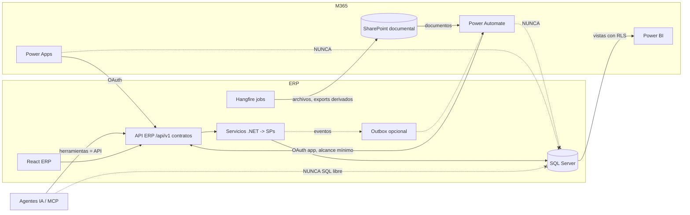
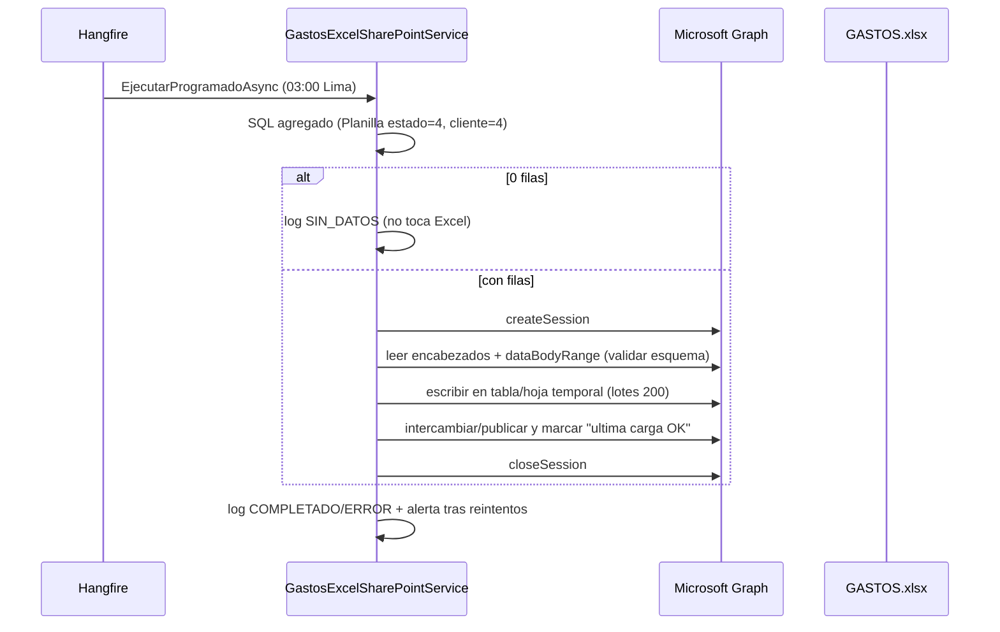

# 07 - Integración ERP <-> SharePoint / Microsoft 365

> Análisis de SOLO LECTURA, 2026-10-14. Repo `Cj-Erp-Web/`. No se leyeron valores de `appsettings*`, no se llamó a Graph, SharePoint ni Azure.
> Convención: **[HECHO]** = comprobado en código/SQL/docs del repo. **[INFERENCIA]** = deducción técnica. **[RIESGO]**, **[RECOMENDACIÓN]**. **PV** = pendiente de validación (tenant Azure/SharePoint/BD real).
> Las secciones "Situación informada / comprobada / hipótesis / evidencia pendiente" separan lo que dicen las personas de lo que prueba el código. **No se inventa el funcionamiento interno del ecosistema SharePoint/Power Apps/Power Automate/skills de Claude.**

---

## 1. Resumen ejecutivo

1. **La integración real es de un solo sentido ERP -> SharePoint**, mediante Microsoft Graph con credenciales de aplicación (client credentials). Cuatro usos comprobados: (a) subida de archivos (facturas/fotos de gasto, cheques, comunicaciones móviles, adjuntos, plantillas, firmas), (b) export diario de asistencia en JSON, (c) actualización diaria de la tabla Excel `TBL_GASTOS` del libro `GASTOS.xlsx`, (d) correo saliente por Graph (`Mail.Send`).
2. **Lo que consume el ecosistema SharePoint/Power Apps/Power Automate NO está en este repo.** No hay un solo artefacto de Power Automate, Power Apps, Logic Apps, Service Bus o Event Grid: **NO ENCONTRADO** (grep sobre BE, FE, SQL, docs). Todo lo que se diga sobre flujos o apps de esa plataforma es **no verificable** desde el código.
3. **El Excel `GASTOS.xlsx` es hoy una interfaz de datos informal**: agregado (no detalle) de gastos pagados del cliente 4, reescrito completo cada noche. Funciona, pero es frágil (ver §4) y no es un contrato.
4. **No existe ningún canal de vuelta** SharePoint/Power Platform -> ERP (no hay endpoints consumidos por Power Automate, ni webhooks de Graph). El único webhook entrante es WhatsApp (Meta), anónimo y sin validación de firma.
5. **Recomendación central:** mantener SharePoint como repositorio documental y colaboración; **no** como motor de datos operativos ni de aprobaciones del ERP; exponer **contratos API versionados y autenticados** (opción G: híbrida con contratos) y que Power Apps/Power Automate/agentes IA solo consuman esas APIs, **sin escritura directa a SQL**.

---

## 2. Diagnóstico de la integración actual (comprobado en código)

### 2.1 Componentes

| Componente | Archivo | Rol |
|---|---|---|
| `ISharePointCommercialUploadService` | `CjERP.Api/Services/SharePointCommercialUploadService.cs` (677 líneas) | Subir/descargar archivos (Graph `drives/{id}/root:/{ruta}:/content`), reemplazar cuerpo de tabla Excel (`ISharePointExcelTableService`, mismo servicio) |
| `GraphExcelTableWriter` | `CjERP.Infrastructure/Services/Graph/GraphExcelTableWriter.cs` | API de libros de Graph: `createSession` -> `dataBodyRange` -> `clear` -> `PATCH range` por lotes de 200 -> `closeSession` (siempre) |
| `IGraphMailSender` / `GraphMailSender` | `CjERP.Infrastructure/Services/Graph/GraphMailSender.cs` | `POST /users/{remitente}/sendMail`, adjuntos <= 3 MB (documentado). Remitente `TI2@cj-telecom.com` |
| `AsistenciaSharePointService` + `AsistenciaSharePointJob(+Scheduler)` | `CjERP.Api/Services/`, `CjERP.Api/Jobs/` | Export JSON de asistencia |
| `GastosExcelSharePointService` + `GastosExcelSharePointJob` + `GastosExcelSharePointJobScheduler` | `CjERP.Api/Services/`, `CjERP.Api/Jobs/` | Export a Excel |
| `GastosExcelSharePointRepository` | `CjERP.Infrastructure/Repositories/` | SQL inline de agregado + config + log; **crea tablas si faltan** (`EnsureSchemaAsync`) |
| Controllers | `GastosExcelSharePointController` (`/api/admin/gastos-excel-sharepoint`), `AsistenciaSharePointController` | Config, ejecución manual, historial, reintento; acceso administrativo |
| FE | `features/administracion/exportacionasistnciasharepointpage.tsx`, `GastosExcelJobPanel.tsx`; `utils/sharepoint.ts` (`SHAREPOINT_BASE_URL` fija en el front) | UI de jobs y construcción de URLs |
| Tablas | `AsistenciaSharePointJobConfig/ExportLog`, `GastosExcelSharePointJobConfig/Log`, `ReporteWhatsAppLog` | Config y log de ejecuciones (`Database/Reportes/01*`, `02*`) |

### 2.2 Autenticación y permisos
- **[HECHO]** OAuth2 client_credentials contra `login.microsoftonline.com/{tenant}`, scope `graph.microsoft.com/.default`. **Token, `siteId` y `driveId` se solicitan en cada operación (sin caché)** (`docs/INTEGRATIONS.md`; confirmado en `ReplaceTableBodyAsync`: `GetAccessTokenAsync` -> `GetSiteIdAsync` -> `GetDriveIdAsync`).
- **[HECHO]** Los únicos permisos de Graph **nombrados en docs**: `Mail.Send` (aplicación, con consentimiento de administrador). Para SharePoint/Excel el código usa `.default` (los permisos concedidos dependen de la app de Azure): **PV** (esperable `Sites.ReadWrite.All` o `Sites.Selected` + `Files.ReadWrite.All` para el libro; **no está documentado**). `docs/INTEGRATIONS.md` marca como **PV** los permisos de aplicación sobre Excel.
- **[RIESGO]** Si se usa `.default` con `Sites.ReadWrite.All`, la misma credencial puede leer/escribir **todo** el tenant SharePoint: alcance excesivo frente al uso real (carpetas puntuales). **[RECOMENDACIÓN]** migrar a `Sites.Selected` limitado al sitio/biblioteca usados y mantener `Mail.Send` limitado con política de acceso de aplicaciones (Exchange) al buzón de TI2.
- **[RIESGO]** `ClientSecret` en configuración; rotación pendiente según `TECHNICAL_DEBT.md C6` / Viáticos Fase 5 (no se verificaron valores). **[RECOMENDACIÓN]** certificado o secreto con vencimiento corto en Key Vault/variables Railway.

### 2.3 Export de asistencia (JSON)
| Aspecto | Hecho comprobado |
|---|---|
| Qué se exporta | Resultado de `sp_asistencia_buscarporfechas_job`: idEmpleado, nombreEmpleado, fecha, hora, horaSalida, latitud/longitud de salida, idEstado, estado; con `fechaGeneracion`, `procedimiento`, `origen: "JC_Db"` |
| Frecuencia | Hangfire `AsistenciaSharePointJob`, `Cron.Daily` (por defecto 02:00 Lima, configurable en `AsistenciaSharePointJobConfig`); rango = **primer día del mes hasta hoy** |
| Formato / nombre | JSON indentado, `Asistencia_{yyyyMMdd}.json` (fecha fin) en carpeta `SharePoint:Asistencia:FolderPath` (por defecto `Asistencia`) |
| Idempotencia | `PUT .../content` **sobreescribe** el archivo del día (mismo nombre); relanzar el mismo día es seguro. Un archivo por día con el acumulado del mes |
| Errores/reintentos | `AutomaticRetry(Attempts=3, 30/60/120 s)`; log en `AsistenciaSharePointExportLog` (INICIADO/COMPLETADO/SIN_DATOS/ERROR); reintento manual desde UI |
| Observación | Se escribe archivo aun con 0 filas (estado SIN_DATOS); `Reemplazado` se devuelve siempre `true` (informativo) |
| Datos sensibles | Nombres y coordenadas GPS de empleados en JSON plano |

### 2.4 Export a Excel (GASTOS.xlsx / TBL_GASTOS)
| Aspecto | Hecho comprobado |
|---|---|
| Qué se exporta | **Agregado** de `dbo.Planilla` (LEFT JOIN `Site`, `Proyecto`, `Cliente`, `Constante` moneda/tarea): `IdSite, NombreSite, Anio (YEAR(FechaDeposito)), Proyecto, Cliente, Trabajo (Tipo_Trabajo), Tarea, TotalGastos (SUM TotalPagar), Moneda` + columna "actualización" (texto `dd/MM/yyyy HH:mm`, Lima). Filtro `IdCliente = @IdCliente AND Estado = @Estado` (defecto **cliente 4, estado 4 = pagado**, editable en `GastosExcelSharePointJobConfig`) |
| Frecuencia | `Cron.Daily` 03:00 Lima, **activo por defecto** (la rutina `EnsureSchema` reactiva la config solo si nadie la ha guardado) |
| Archivo/tabla | `GASTOS.xlsx`, tabla `TBL_GASTOS` (nombres por defecto en `SharePointGastosExcelOptions`; carpeta configurable; si no hay carpeta se **busca el archivo por nombre** en toda la biblioteca) |
| Mecanismo | Graph workbook: sesión persistente, lee `dataBodyRange` (hoja/fila/columna de inicio), exige `columnasTabla >= columnasDatos`, `clear` del cuerpo, escribe lotes de 200 filas, cierra sesión en `finally` |
| Errores | Reintento HTTP interno hasta 4 intentos para 429/503/504 (respeta `Retry-After`, tope 30 s); Hangfire 3 reintentos (30/60/120 s); `DisableConcurrentExecution(1800)` (no concurrencia); log `GastosExcelSharePointLog` con estado y detalle |
| Protección de datos vacíos | Si la consulta devuelve 0 filas **no toca el Excel** (estado SIN_DATOS) |
| Idempotencia | Funcional (reescribe todo desde el mismo origen) pero **no atómica** (ver riesgos) |
| Autorización de endpoints | `[Authorize]` + comprobación de "acceso administrativo" (`ReporteAutomaticoService.UsuarioTieneAccesoAdministrativoAsync`) |

### 2.5 Riesgos y limitaciones del Excel como integración (comprobables o deducibles)
1. **[HECHO] Acoplamiento a estructura:** el job escribe por **posición** (10 columnas); si alguien reordena/añade columnas o renombra la tabla, el job falla (`columnas insuficientes`) o escribe datos en columnas equivocadas sin error. No hay contrato de esquema ni versión.
2. **[HECHO] No atómico:** entre `clear` y la última escritura, cualquier lector (Power Query, Power BI, Power Automate, usuarios) puede ver la tabla **vacía o parcial**. La sesión es `persistChanges: true`; no hay publicación en dos fases (hoja temporal + swap).
3. **[INFERENCIA] Tamaño de la tabla:** `range.clear` limpia contenido, no elimina filas de la tabla; si hoy hay menos filas que ayer pueden quedar filas vacías dentro de la tabla, y si hay más filas, el rango escrito puede exceder la tabla sin que ésta se expanda. Comportamiento exacto en Excel Online **PV** (prueba controlada).
4. **[HECHO] Pérdida de granularidad:** solo agregado por Site/Año/Proyecto/Cliente/Trabajo/Tarea/Moneda; no hay `Id` de recibo, aprobador ni estado histórico -> sirve para reporte, no para procesos.
5. **[HECHO] Filtro fijo de negocio dentro de la integración:** cliente 4/estado 4; si cambian las reglas se cambia una fila de config, no un contrato.
6. **[HECHO] SQL inline y DDL en código** (`EnsureSchemaAsync` se ejecuta en **cada** consulta); columnas de `Planilla` marcadas **PV**.
7. **[HECHO] Límites de Graph:** sesiones y rangos grandes; lotes de 200 filas evitan límites de payload, pero no hay paginación del lado de lectura ni control de límite de filas de tabla.
8. **[RIESGO] Dependencia de nombre de archivo y búsqueda global** si no hay carpeta configurada: dos archivos con el mismo nombre en la biblioteca causan ambigüedad (el código toma el primero con nombre exacto).
9. **[RIESGO] Seguridad/gobierno:** quien tenga acceso de edición al libro puede alterar los datos que otros consumen; no hay firma ni control de versión del dato (SharePoint guarda versiones del archivo, **PV si está habilitado**).
10. **[HECHO] Sin canal de retorno ni notificación:** el consumidor no se entera de la actualización salvo que consulte la columna "actualización".
11. **[HECHO] Sin observabilidad externa:** el estado solo se ve en la tabla de logs y en la UI admin; no hay alerta si el job falla tres veces.

---

## 3. Otras integraciones relevantes (para la comparación de opciones)

| Integración | Estado comprobado | Observación |
|---|---|---|
| Subida de archivos a SharePoint | Facturas de gasto (`GASTO_FOTOS`), `REEMBOLSOS`, `COMUNICACIONES`, `DESCANSO_MEDICO` (carpetas por defecto/config), plantillas DOCX de contratos, firmas de boletas, adjuntos de Viáticos (`ViaticoSharePointFileStorage`) | Descarga por `DownloadFileAsync`; URLs construidas en FE con `SHAREPOINT_BASE_URL` fija |
| Correo | Graph primero (`Mail.Send`), SMTP respaldo (timeout desde Railway) | Regla vigente del repo (`AGENTS.md`) |
| WUP (WhatsApp/SMS propio) | `WupService`, `WupAuthService` HTTP plano; jobs Hangfire de reportes | Credenciales usuario/clave |
| Meta WhatsApp Cloud | `MetaWhatsAppService` (Enabled=false por defecto) | Webhook `/api/whatsapp/webhook` **anónimo, POST sin validación de firma** (`WhatsappWebhookController`) |
| Expo push | `MobilePushDispatchService` | |
| Telegram | **NO ENCONTRADO** (`INTEGRATIONS.md`: "Integraciones no encontradas") | |
| Power Automate / Power Apps / Logic Apps / Service Bus / Event Grid | **NO ENCONTRADO** | Ningún endpoint, doc o SQL los referencia |
| Webhooks de Graph (change notifications) | **NO ENCONTRADO** | |

---

## 4. SharePoint como... (evaluación)

| Rol | Evaluación | Fundamento |
|---|---|---|
| **Repositorio documental** | **Adecuado y ya en uso** | Facturas, adjuntos, plantillas, comunicaciones, actas |
| **Colaboración** | Adecuado | Edición conjunta, versiones, permisos por sitio |
| **Motor de datos operativos** | **Inadecuado** | Listas/Excel sin integridad referencial, sin transacciones, límites de vista/tamaño, concurrencia limitada; el ERP ya tiene SQL Server con SPs |
| **Motor de aprobaciones** | Parcial/condicionado | Power Automate Approvals sirve para flujos livianos y documentos; **no** para los estados/regla de negocio de pagos (estados 0-10, 3 niveles, rol, trazabilidad en `LogPlanilla`). Las aprobaciones del ERP deben seguir en el ERP |
| **Fuente para IA** | Útil para documentos (RAG con permisos del usuario) | **No** para datos transaccionales (esos se consultan por herramientas/APIs) |
| **Datos operativos** | No como fuente de verdad | Solo copias/publicaciones derivadas (reportes), siempre regenerables desde SQL |

---

## 5. Comparación de opciones A-H

Escala: Alta/Media/Baja. "Costo" = relativo (no se estiman montos; licencias Power Platform/Azure **PV**).

| Criterio | **A** Excel -> SP -> Power Automate | **B** API REST -> Power Automate/Power Apps | **C** API -> servicio Azure -> M365 | **D** Eventos -> Service Bus/Event Grid | **E** Graph -> API ERP -> SP | **F** Agentes IA sobre APIs autorizadas | **G** Híbrida con contratos | **H** Alternativas (p. ej. Power BI/ dataflows, ETL programado, Fabric) |
|---|---|---|---|---|---|---|---|---|
| Descripción | Es el estado actual + flujos sobre el archivo | Power Platform llama endpoints del ERP | Función/servicio Azure intermedia ERP y M365 | El ERP publica eventos; consumidores suscritos | M365/Graph hace de origen y el ERP ingiere vía API | Agentes IA usan herramientas = APIs | Contratos API + eventos + exports derivados, cada uno donde conviene | Datos analíticos vía Power BI/ETL sin pasar por Excel |
| Seguridad | Baja-Media (permiso al libro; sin identidad de usuario ERP) | Media-Alta si OAuth/JWT por app y alcance | Alta (Managed Identity, red) | Alta (RBAC Azure) | Media (permisos Graph amplios) | Media-Alta si hereda permisos del usuario | **Alta** (autorización única en la API) | Media (modelo semántico con RLS) |
| Latencia | Alta (batch nocturno) | Baja-Media | Baja-Media | **Baja (casi tiempo real)** | Media | Baja-Media | Según canal | Media (refresco programado) |
| Complejidad | **Baja** | Media | Alta | Alta | Media-Alta | Media-Alta | Media (disciplina de contratos) | Media |
| Disponibilidad | Media (depende de Excel Online, job nocturno) | Media (depende de Power Platform + API) | Alta | Alta | Media | Media | Alta | Alta |
| Escalabilidad | Baja | Media | Alta | Alta | Media | Media | Alta | Alta |
| Costo | Bajo | Medio (licencias premium si conectores personalizados) | Medio-Alto | Medio-Alto | Medio | Medio (tokens) | Medio | Medio |
| Trazabilidad | Baja | Media (historial de flujos) | Alta | Alta | Media | Alta si auditoría centralizada | **Alta** | Media |
| Mantenimiento | Alto por fragilidad | Medio | Alto | Alto | Alto | Medio | **Medio** | Medio |
| Dependencias | Excel/SharePoint estables | Power Platform, API estable | Azure, DevOps | Azure | Graph, API ERP | AI Gateway, ToolRegistry | Contratos + gobierno | Power BI/Fabric |
| Riesgos | Fragilidad, lecturas parciales | Lógica de negocio dispersa en flujos | Sobreingeniería; más superficie | Complejidad operativa | Doble fuente de verdad | Acciones no deseadas | Requiere gobierno | Fuga por modelo semántico mal asegurado |
| Impacto en ERP actual | Ninguno (existe) | Nuevos endpoints/versionado | Nuevo componente | Outbox/eventos en ERP | Nuevos endpoints de ingesta | Catálogo de herramientas | Endpoints + versionado + outbox ligero | Nulo en ERP |

### Lectura
- **A** es el punto de partida; adecuada solo para **reportes derivados** con consumo humano o Power BI, no para procesos.
- **B** es viable para **lectura y para acciones simples** si todo pasa por la API del ERP con identidad delegada o de aplicación con alcance mínimo.
- **C y D** se justifican cuando haya **volumen/eventos en tiempo casi real** o varios consumidores; hoy no hay evidencia de esa necesidad (**PV**).
- **E** (Graph -> API ERP) sirve para **ingerir** documentos/metadata (p. ej. un documento aprobado en SharePoint que debe adjuntarse a un expediente del ERP), no para datos maestros.
- **F** depende de `06_Auditoria_IA_y_Agentes.md` (AI Gateway, ToolRegistry, permisos heredados).
- **H** (Power BI sobre vistas/SPs del ERP con RLS) suele reemplazar con ventaja al Excel para consumo analítico. **[HIPÓTESIS]**: confirmar si el equipo ya usa Power BI.
- **Recomendada: G (híbrida con contratos)**: API REST versionada como único contrato de escritura y lectura operativa; **outbox de eventos** solo si aparece el segundo consumidor en tiempo casi real; exports derivados (Excel/JSON/Power BI) **regenerables** y marcados como "no fuente de verdad".

---

## 6. Reglas de arquitectura propuestas (normativas para este tema)

1. **Ninguna escritura directa a SQL desde Power Apps, Power Automate, agentes IA ni Excel.** Toda escritura pasa por un endpoint del ERP que reutiliza el servicio de dominio (misma validación, auditoría `AuditoriaCambios`, reglas de estado).
2. **Identidad:** llamadas de usuario con JWT del ERP (o token delegado); llamadas de proceso con una **identidad de aplicación dedicada por consumidor** y alcance mínimo (no compartir credencial). Hoy el backend no valida roles (solo JWT) -> **prerrequisito: autorización por rol/permiso en los endpoints expuestos** (`TECHNICAL_DEBT`).
3. **Contratos versionados** (`/api/v1/...`) con OpenAPI publicada; cambios incompatibles = nueva versión.
4. **Idempotencia:** `Idempotency-Key` en POST de integración; reintentos seguros.
5. **Eventos** solo mediante **outbox transaccional** en SQL (no dual-write).
6. **Exports derivados**: marcados como derivados, regenerables, con versión de esquema y publicación en dos fases (ver §8).
7. **Secretos** fuera del repo; rotación; permisos Graph `Sites.Selected`.

### 6.1 Cuándo Power Apps vs React
| Usar Power Apps | Usar React (ERP) |
|---|---|
| Formularios ligeros de uso interno ocasional, captura en campo sin lógica compleja, prototipos | Procesos del núcleo (pagos, OC, aprobaciones, RRHH), grillas grandes (`DataGridPro`), permisos finos, reglas de estado |
| Siempre llamando a la API del ERP | Fuente única de UI de negocio |
Criterio: si el proceso tiene estados, reglas, auditoría o seguridad por perfil, va en React (o mobile Expo); Power Apps solo como cliente delgado de la API.

### 6.2 Cuándo Power Automate vs Hangfire/.NET/Functions
| Power Automate | Hangfire/.NET (o Azure Functions) |
|---|---|
| Flujos centrados en M365 (notificaciones Teams/Outlook, aprobaciones documentales, movimiento de archivos entre bibliotecas, Planner) por personal no desarrollador | Procesos de negocio del ERP, jobs con SQL y lógica transaccional, reintentos con control, tests y versionado en repo |
| Disparadores en SharePoint/Outlook | Jobs programados y colas que tocan la BD |
Criterio: **lógica de negocio y datos del ERP -> código versionado (Hangfire/.NET)**; **orquestación de herramientas M365 sin lógica de negocio -> Power Automate**, llamando a la API.

### 6.3 Qué mantener en SharePoint vs incorporar al ERP
| Mantener en SharePoint | Incorporar/gestionar en el ERP |
|---|---|
| Documentos (facturas, contratos, actas, boletas firmadas, fotos), bibliotecas con permisos por sitio, plantillas | Datos maestros y transaccionales con estado (gastos, pagos, OC, asistencia, empleados) |
| Archivos derivados para lectura (reportes, JSON diario) | Metadatos mínimos del documento (ruta/Id Graph, hash, tipo, quién subió) **en tablas del ERP** para trazabilidad, en lugar de depender solo de la ruta de carpeta |

### 6.4 Qué hacer con las exportaciones Excel
1. **Corto plazo (sin cambiar de arquitectura):** documentar el esquema de `TBL_GASTOS` como contrato (columnas, tipos, orden); añadir **validación de encabezados** antes de escribir (leer `headerRowRange` y comparar); escribir en una **hoja/tabla temporal y cambiar** al final (o al menos dejar marca "actualizando" y fecha de última carga exitosa en una celda aparte); alerta (correo Graph/WUP) si el job falla tras sus reintentos; prueba controlada del comportamiento de redimensionado de tabla (§2.5 punto 3).
2. **Medio plazo:** reemplazar el consumo por **Power BI sobre una vista/SP del ERP con RLS** o por un endpoint `GET /api/v1/reportes/gastos-agregados` (opción H/G). Mantener el Excel solo si existe una necesidad humana concreta.
3. **Largo plazo:** retirar la escritura al libro cuando ningún consumidor dependa de él (inventariar consumidores con el equipo SharePoint, preguntas §10).
4. **Asistencia JSON:** conservar como respaldo/archivo; si lo consume un flujo, proveer endpoint equivalente y versión de esquema.

---

## 7. Contratos API propuestos (basados en endpoints/SPs reales)

> **Propuesta**: no existen aún como contratos versionados. Se parte de endpoints/SPs verificados en `docs/API_MAP.md`, `docs/DATABASE_MAP.md` y código. Antes de crear un endpoint nuevo, aplicar la regla del repo de revisar Controllers/Services existentes (no duplicar). Marcar **PV** los campos que dependan de columnas no versionadas.

| Contrato | Verbo/ruta propuesta (v1) | Origen real | Campos (resumen) | Notas |
|---|---|---|---|---|
| **Proyectos** | `GET /api/v1/proyectos`, `GET /api/v1/proyectos/{id}` | `Proyecto`, `Cliente`, `Site`, lookups `sp_Importar_*` (`LookupController`) | idProyecto, nombre, idCliente, cliente, estado | Solo lectura inicialmente |
| **Empleados** | `GET /api/v1/empleados`, `GET /api/v1/empleados/{id}` | `sp_EmpleadoCj_Listar_Wup`, `sp_Empleado_Cta_Listar`, `EmpleadoCj` | idEmpleadoCj, nombre, cargo, estado (9/1/0) | **Excluir datos sensibles** (cuentas, sueldos) salvo permiso; Ley 29733 |
| **OT** | `GET /api/v1/ot`, `GET /api/v1/ot/{id}/resumen` | `importar`, `sp_Importar_OT_Listar`, `sp_Importar_ResumenOT_MontoPagadoOc` | idOt, cliente, proyecto, site, monto OC, monto pagado | |
| **Estados de pago** | `GET /api/v1/pagos?estado=&desde=&hasta=`, `GET /api/v1/pagos/{id}/historial` | `sp_Planilla_ConsultaIni`, `sp_Planilla_Consulta_Estados`, `LogPlanilla`, `MovEstadosPagos` | correlativo, estado, fechas, montos, moneda, ocId/fila | Estado 4 = pagado; reglas en `BUSINESS_RULES.md` |
| **Aprobaciones** | `POST /api/v1/aprobaciones/{tipo}/{id}/decision` (aprobar/observar/rechazar) | `sp_Planilla_ProcesarAprobacionMasiva`, `sp_OrdenCompra_RechazarMasivo`, `sp_EmpleadoCompensacion*`, vacaciones | idObjeto, decision, motivo; **aprobador desde JWT, no del body** | Hoy algunos endpoints toman aprobador del body (deuda); el contrato nuevo no debe |
| **Documentos** | `POST /api/v1/documentos` (metadata + subida), `GET /api/v1/documentos/{id}` | `ISharePointCommercialUploadService.UploadBytesAsync/DownloadFileAsync` | idDocumento, tipo, entidad/idEntidad, ruta SharePoint/IdGraph, hash, usuario | Introduce metadatos en BD (revisar tablas existentes antes de crear) |
| **Reporte agregado de gastos** | `GET /api/v1/reportes/gastos-agregados?cliente=&estado=` | Misma consulta que `GastosExcelSharePointRepository.GastosSql` | Mismas 9 columnas | Sustituto del Excel para consumidores |
| **Eventos (opcional)** | outbox `PagoEstadoCambiado`, `OcAprobada`, `GastoRegistrado` | `LogPlanilla`/`MovEstadosPagos` | idEvento, tipo, versión, payload, fecha | Solo si hay consumidor en tiempo casi real |

Requisitos de contrato: autenticación OAuth2/JWT, autorización por permiso (no solo "autenticado"), paginación y límites, errores estándar (`{success,message,data}` coherente con el repo), `Idempotency-Key`, OpenAPI.

---

## 8. Diseño recomendado para el Excel (si se mantiene)

Hoy el flujo real omite los pasos de validación de encabezados, tabla temporal y alerta (ver §2.4/§2.5). **[RECOMENDACIÓN]** implementarlos solo si el Excel se mantiene; son mejoras acotadas dentro de `GraphExcelTableWriter`/`GastosExcelSharePointService` (sin tocar contratos externos).

---

## 9. Situación informada / comprobada / hipótesis / evidencia pendiente

### 9.1 Situación informada (dicha por personas o por el encargo; **no** verificada en el repo)
- Existe un ecosistema SharePoint/Power Apps/Power Automate gestionado por otro equipo, y skills de Claude (`auditor-gastos`, `ayuda`, `acta-reunion`) que usan SharePoint (casos/precedentes, memoria de ayuda, actas; `acta-reunion` menciona Planner vía Power Automate y Teams en su descripción).
- Se habla de que Power Apps/Power Automate podrían interactuar con datos del ERP.

### 9.2 Situación comprobada (en el repo)
- ERP -> SharePoint por Graph (client credentials): archivos, JSON de asistencia, tabla Excel de gastos, correo.
- Jobs Hangfire, logs en BD, reintentos, `DisableConcurrentExecution` (Excel), idempotencia por sobreescritura.
- **No hay** artefactos de Power Automate/Power Apps/Logic Apps/Service Bus/Event Grid/Telegram/MCP; **no hay** archivos de skills de Claude (no existe `.claude/` en el repo) -> los skills son **NO VERIFICABLES**.
- Webhook WhatsApp anónimo sin firma; backend sin autorización por rol (solo JWT) salvo excepciones.
- Documentación de permisos Graph: solo `Mail.Send` explícito; Excel/Sitios **PV**.

### 9.3 Hipótesis (a validar; marcadas como tales)
- H1: Power Apps/Power Automate consumen `GASTOS.xlsx` o los JSON de `Asistencia/` (no hay evidencia en el repo de consumidores).
- H2: La app de Azure usa permisos amplios de sitios (`Sites.ReadWrite.All`) por el uso de `.default`.
- H3: Los skills de Claude leen/escriben en SharePoint con la identidad de cada usuario o conectores propios (desconocido).
- H4: Hay versionado habilitado en la biblioteca que aloja `GASTOS.xlsx` (mitigaría sobrescrituras).
- H5: Existen licencias de Power Platform premium (necesarias para conectores personalizados) y Power BI.

### 9.4 Evidencia pendiente
1. Inventario de consumidores de `GASTOS.xlsx` y `Asistencia_*.json` (flujos, Power BI, personas).
2. Lista de permisos de aplicación concedidos a la app de Azure (SharePoint/Excel/Mail).
3. Estructura de sitios/bibliotecas/carpetas y permisos (sin URLs con secretos).
4. Resultado de prueba controlada del `clear` + escritura sobre tabla (¿filas vacías? ¿expansión?).
5. Definición real de los flujos y skills (exportes de solución, no solo descripciones).
6. Fuente de ingresos/presupuesto por proyecto (para cruces futuros).

---

## 10. Preguntas para el equipo SharePoint / Power Platform

1. ¿Qué flujos de Power Automate o apps de Power Apps existen hoy y cuáles leen/escriben datos del ERP o de `GASTOS.xlsx`/`Asistencia_*.json`? ¿Quién es dueño de cada uno?
2. ¿Los flujos usan identidad de usuario, de servicio o conexiones compartidas? ¿Dónde se guardan las credenciales?
3. ¿Qué permisos de aplicación tiene la app de Azure del ERP sobre SharePoint/Excel/Mail? ¿Es posible migrar a `Sites.Selected`?
4. ¿Cuál es la estructura de sitios/bibliotecas y quién puede editar `GASTOS.xlsx`? ¿Hay versionado y papelera configurados?
5. ¿Qué datos del ERP necesitan realmente los flujos (campos, frecuencia, latencia)? ¿Bastaría con un endpoint o evento?
6. ¿Hay procesos de aprobación en SharePoint/Power Automate que dupliquen aprobaciones del ERP?
7. ¿Qué skills de Claude (`auditor-gastos`, `ayuda`, `acta-reunion`) están en uso, con qué conector/credencial acceden a SharePoint y qué carpetas/listas modifican?
8. ¿Existen listas de SharePoint con datos operativos (empleados, proyectos, OT) que compitan con el ERP como fuente de verdad?
9. ¿Qué licencias hay (Power Platform premium, Power BI Pro/PPU, Microsoft 365 Copilot, Azure)? Condicionan B, C, H y la iniciativa de búsqueda semántica.
10. ¿Qué política de retención, DLP y etiquetado de sensibilidad aplica a los sitios con facturas, contratos y asistencia?
11. ¿Qué SLA se espera para las exportaciones (hora de refresco, tolerancia a datos vacíos/parciales)?
12. ¿Se acepta que los flujos consuman únicamente API del ERP (sin acceso directo a SQL) como regla de gobierno?

---

## 11. Plan de acción sugerido

| Plazo | Acción | Riesgo que reduce |
|---|---|---|
| Inmediato | Inventariar consumidores del Excel/JSON; alerta de fallo de jobs; revisar permisos Graph reales; documentar el esquema `TBL_GASTOS` | Fragilidad, alcance excesivo |
| 1-2 sprints | Validación de encabezados y marca de "última carga OK"; prueba de comportamiento de tabla; `GET reportes/gastos-agregados` | Lecturas parciales, ruptura silenciosa |
| 1-3 meses | Contratos `v1` (proyectos, OT, pagos, documentos) con identidad de aplicación por consumidor; autorización por permiso en endpoints expuestos | Escritura insegura, doble fuente |
| 3-6 meses | Power BI con RLS para analítica; outbox de eventos solo si hay consumidor; migrar a `Sites.Selected`; metadatos documentales en BD | Gobierno y trazabilidad |
| Condicionado | Servidor MCP/agentes sobre los mismos contratos (ver `06`) | IA con permisos heredados |

Documentos a actualizar al implementar (regla del repo): `docs/INTEGRATIONS.md`, `docs/API_MAP.md`, `docs/ARCHITECTURE.md`.
