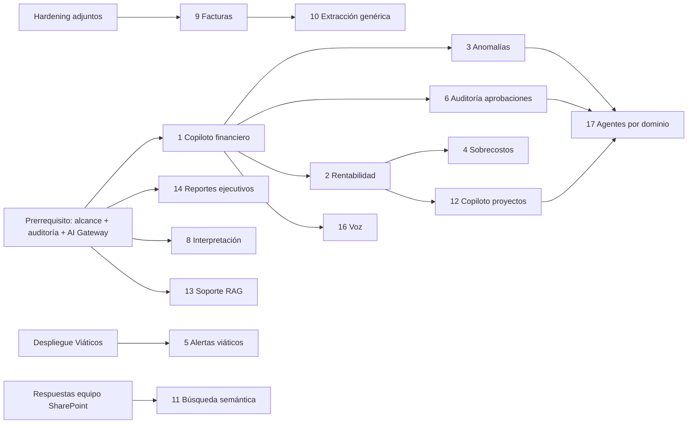

# 13 - Catálogo de Oportunidades de IA (CJ ERP Web)

> Análisis de SOLO LECTURA, 2026-10-14. Complementa `06_Auditoria_IA_y_Agentes.md` (leerlo primero: hallazgos IA-01..IA-17).
> Convención: **[HECHO]** comprobado en código/SQL del repo; **[INFERENCIA]**; **[SUPUESTO]** no verificable (costos, volúmenes, metas); **PV** pendiente de validación en BD/negocio.
> **Costos: no se inventan precios.** Se expresan como esfuerzo relativo (S/M/L/XL) y como rubros a presupuestar; las cifras en "esfuerzo" son supuestos de planificación (persona-semana) a validar con el equipo.
> **Prerrequisito común (bloqueante P0):** activar el alcance por usuario del chat (IA-01), auditoría (IA-03) y AI Gateway mínimo (IA-04/IA-05). Ninguna iniciativa debe salir a producción sobre la ruta actual sin alcance.

---

## 0. Inventario real de datos disponibles (base para todas las iniciativas)

| Dato | Dónde (comprobado) | Calidad / nota |
|---|---|---|
| Gastos/recibos | `dbo.Planilla` (IdSite, CorreSite, IdProyecto, IdCliente, Tipo_Trabajo, IdTarea, FechaDeposito, TotalPagar, TipoMoneda, Estado 0-10; "pagado" = Estado 4) - `GastosExcelSharePointRepository.GastosSql`, `sp_Planilla_*` | DDL no versionado (PV columnas); campo libre "Detalle" |
| Historial de estados de pago | `LogPlanilla`, `MovEstadosPagos` (`docs/DATABASE_MAP.md`) | PV completitud y granularidad |
| Consulta analítica IA | `sp_IA_Planilla_Buscar` (+ modo RESUMEN, scripts `16`/`17` en repo) | SP vigente en BD: 18 params; versión con alcance 22 params no ejecutada (PV) |
| Ingresos/gastos por proyecto | `sp_Movimientos_Consulta_GastosIngresos`, `sp_Importar_ConsultaDsh`, `sp_Importar_ResumenOT_*` (`Database/Planilla/03*`) | Existen dashboards gerenciales |
| OC | `CabOrdenCompra`, `DetOrdenCompra`, `Planilla.IdOc+Fila`; `sp_OrdenCompra_*` | Cadena de aprobación 3 niveles |
| Asistencia | `Asistencia` (lat/long, hora, estado), `RptAsistenciaFechas`, `sp_AsistenciaTracking_Consulta`, export JSON a SharePoint | Estado 9 = pendiente de validar |
| Aprobaciones | Estados en Planilla/Vacaciones/Compensación/Contratos; `AuditoriaCambios` (`sp_AuditoriaCambios_Registrar`) | Aprobador/usuario a veces tomado del body (`TECHNICAL_DEBT`) -> calidad de auditoría limitada |
| Conciliación bancaria | `MovimientosConciliacion`, `MovimientosBcp`, plantillas por banco; análisis OpenAI opcional | |
| Viáticos | Fases 1-3 en repo (DDL/SP/backend `Services/Viaticos`), **nada desplegado en JC_Db** (memoria de proyecto; PV) | Sin datos históricos hasta despliegue |
| Comprobantes (imágenes/PDF) | SharePoint (`GASTO_FOTOS`, `UploadExpenseInvoiceAsync`), gestor legacy `elnk.uno` | No hay OCR/extracción en el ERP [HECHO: sin referencias] |
| Documentos/plantillas | SharePoint (contratos DOCX, boletas, comunicaciones) | |
| Excel hacia SharePoint | `GASTOS.xlsx`/`TBL_GASTOS` (agregado por Site/Año/Proyecto/Cliente/Trabajo/Tarea/Moneda) | Es un agregado, no el detalle |
| Catálogos | `Constante` (campo/correlativo) | |
| Documentación funcional | `docs/*.md`, `AGENTS.md`, `CjERP.Backend/Docs/*` | Base de RAG de soporte |

Convención de prioridad: **A** = hacer primero, **B** = siguiente ola, **C** = condicionado/largo plazo. Valor/Esfuerzo/Riesgo en escala Alto/Medio/Bajo.

---

## 1. Tabla resumen priorizada

| # | Iniciativa | Valor | Esfuerzo | Riesgo | Datos listos | Prioridad | Ola |
|---|---|---|---|---|---|---|---|
| 1 | Copiloto financiero (consulta de gastos/pagos/OC en lenguaje natural) | Alto | Medio | Medio | Sí (Planilla) | **A** | 1 |
| 14 | Reportes ejecutivos automáticos | Alto | Bajo-Medio | Bajo | Sí | **A** | 1 |
| 8 | Interpretación de reportes/dashboards | Medio | Bajo | Bajo | Sí | **A** | 1 |
| 13 | Soporte ERP (preguntas funcionales, RAG docs) | Medio | Bajo-Medio | Bajo | Sí (docs) | **A** | 1 |
| 3 | Detección de anomalías y duplicidades en gastos | Alto | Medio | Medio | Sí (Planilla+Log) | **A** | 2 |
| 6 | Auditoría de aprobaciones | Alto | Medio | Medio | Parcial | **A/B** | 2 |
| 2 | Rentabilidad por proyecto/OT | Alto | Medio-Alto | Medio | Parcial | **B** | 2 |
| 5 | Alertas de viáticos | Medio | Bajo-Medio | Bajo | No hasta despliegue | **B** | 2 |
| 9 | Procesamiento de facturas/comprobantes | Alto | Alto | Medio-Alto | Parcial (imágenes) | **B** | 3 |
| 10 | Extracción PDF/Excel/imagen genérica | Medio | Medio | Medio | Parcial | **B** | 3 |
| 15 | Automatización documental (borradores) | Medio | Medio | Medio | Parcial | **B** | 3 |
| 7 | Asistencia/productividad | Medio | Medio | Alto (personal) | Sí | **B/C** | 3 |
| 4 | Predicción de sobrecostos | Alto | Alto | Medio | Parcial | **C** | 3 |
| 11 | Búsqueda semántica SharePoint | Medio | Medio-Alto | Medio | Externo (SharePoint) | **C** | 3 |
| 12 | Copiloto de proyectos | Medio | Alto | Medio | Parcial | **C** | 4 |
| 17 | Agentes por dominio | Alto (a largo plazo) | Alto | Alto | Depende de 1/3/6 | **C** | 4 |
| 16 | Voz | Bajo-Medio | Bajo (ya hay navegador) | Bajo | N/A | **C** | 4 |

Orden recomendado: 1 -> 14/8/13 (rápidos) -> 3/6 -> 2/5 -> 9/10/15 -> 7/4/11 -> 12/17/16.

Lectura de la tabla: la ola 1 reutiliza al máximo lo existente (IA Chat, `sp_IA_Planilla_Buscar`, dashboards). La ola 2 aprovecha `LogPlanilla/MovEstadosPagos` y datos de OC. La ola 3 exige modelos multimodales o integración con SharePoint. La ola 4 depende de ToolRegistry, permisos y aprobación humana maduros.

---

## 2. Fichas

Formato: Problema - Beneficio medible - Datos (disponibilidad REAL) - Arquitectura - Integraciones - Riesgos - Complejidad/costos - Prioridad - Dependencias - MVP - Métricas.

### 1. Copiloto financiero
- **Problema:** consultar gastos/pagos/OC exige conocer filtros de pantallas (`pagos_v1`, `oc_v1`, reportes). Existe un chat de solo gastos pero con alcance no aplicado (IA-01).
- **Beneficio medible:** reducción del tiempo de obtención de un dato (de minutos en pantallas a segundos); nº de consultas resueltas sin soporte de TI. Metas = **[SUPUESTO]** a medir línea base.
- **Datos:** [HECHO] Planilla vía `sp_IA_Planilla_Buscar` (detalle y resumen por Cliente/Proyecto/Site/OT/Responsable/Solicitante/estado/moneda); OC y pagos por SP existentes `sp_OrdenCompra_*`, `sp_Planilla_ConsultaIni` (no expuestos al chat). Disponibilidad: **Alta** para gastos, **Media** para OC/pagos (nuevas herramientas).
- **Arquitectura:** evolución de `IaOrchestrator` a orquestador con `IaToolRegistry`: herramientas de solo lectura `buscar_planilla`, `resumen_planilla`, `estado_pago`, `buscar_oc`; autorización por `IaToolPermiso` (Propio/Equipo/Total). Salida a gráficos con `recharts` (no HTML libre).
- **Integraciones:** SQL (SPs), proveedor LLM vía AI Gateway.
- **Riesgos:** fuga por alcance (IA-01), alucinación numérica (mitigar: cifras siempre de la herramienta), costo, PII al proveedor (IA-05).
- **Complejidad:** Media. **Costos (rubros):** tokens por consulta (estimar con `usage` tras captura), 4-8 persona-semanas **[SUPUESTO]**.
- **Prioridad:** A. **Dependencias:** activar alcance, auditoría, AI Gateway.
- **MVP:** activar E1-E6 existentes + 2 herramientas nuevas (`estado_pago`, `buscar_oc`) para perfiles Finanzas/Gerencia.
- **Métricas:** % consultas con respuesta correcta (conjunto dorado), latencia p95, costo por consulta, consultas denegadas correctamente, adopción semanal.

### 2. Rentabilidad por proyecto/OT
- **Problema:** margen real por proyecto requiere cruzar ingresos (facturación/OC) con gastos pagados; hoy está en dashboards separados.
- **Beneficio:** visibilidad de margen por OT/proyecto casi en tiempo real; detección temprana de pérdidas. Meta **[SUPUESTO]**.
- **Datos:** [HECHO] gastos por proyecto (Planilla Estado 4), `sp_Movimientos_Consulta_GastosIngresos`, `sp_Importar_ConsultaDsh`, `sp_Importar_ResumenOT_MontoPagadoOc` y variantes (`Database/Planilla/03*`). [INFERENCIA] ingresos/facturación como módulo propio: el módulo comercial `facturacion.tsx`/`cobranzas.tsx` es **stub** (`AGENTS.md`); "Facturación electrónica real: no existe". Disponibilidad: **Media-Baja** para ingresos (PV de la fuente de verdad de ingresos: ¿OC cliente? ¿Sytex/hoja Excel?).
- **Arquitectura:** el cálculo debe ser **determinista en SQL/servicio** (vista de margen); la IA solo explica y detecta desvíos (herramienta `margen_proyecto`).
- **Integraciones:** SQL; eventual fuente externa de ingresos (PV).
- **Riesgos:** definición de margen sin consenso, tipo de cambio fijo 3.8 en reglas (`BUSINESS_RULES`), calidad de imputación a proyecto.
- **Complejidad:** Media-Alta (depende de definir datos de ingresos). **Costos:** 6-10 persona-semanas **[SUPUESTO]**.
- **Prioridad:** B. **Dependencias:** definición de ingresos, iniciativa 1.
- **MVP:** tabla "gasto pagado vs monto OC" por OT con explicación en lenguaje natural (ya hay `ResumenOT_MontoPagadoOc`).
- **Métricas:** % de OT con margen calculable, diferencia vs reporte financiero, tiempo de cierre mensual.

### 3. Detección de anomalías y duplicidades en gastos
- **Problema:** pagos duplicados, montos atípicos, traslapes de fechas/viáticos, unitarios fuera de rango. Ya existe un skill externo "auditor-gastos" (ver §3) pero **no hay detector en el ERP**.
- **Beneficio:** pérdida evitada (monto de duplicados detectados / total pagado); tiempo de auditoría.
- **Datos:** [HECHO] Planilla (monto, fecha, responsable, solicitante, proveedor/documento: PV columnas), `LogPlanilla`. Disponibilidad: **Alta** para reglas, **PV** para campos de documento (serie-número) y proveedor.
- **Arquitectura:** **primero reglas y estadística en SQL/.NET** (clave de duplicidad, z-score por tipo de gasto, ventanas de fechas); LLM solo para explicar/priorizar y redactar observación. Resultado = lista de **hallazgos propuestos**; observar/rechazar lo hace el humano con las acciones existentes (estado 7 observada).
- **Integraciones:** Job Hangfire nocturno; notificación por Graph mail (`ISmtpMailSender`).
- **Riesgos:** falsos positivos (fatiga), sesgo, tratamiento de datos personales de empleados; no automatizar sanción.
- **Complejidad:** Media. **Costos:** 4-8 persona-semanas **[SUPUESTO]**; costo LLM bajo (solo explicación).
- **Prioridad:** A (ola 2). **Dependencias:** AI Gateway, tabla de hallazgos (nueva; revisar antes tablas existentes `AuditoriaCambios`).
- **MVP:** reporte semanal de posibles duplicados (mismo monto+fecha+responsable/proveedor) enviado a Tesorería.
- **Métricas:** precisión (% hallazgos confirmados), recall en muestra auditada, monto recuperado/evitado, tiempo de revisión.

### 4. Predicción de sobrecostos
- **Problema:** detectar proyectos que excederán presupuesto/OC antes de que ocurra.
- **Beneficio:** alertas anticipadas, menos sobrecostos no aprobados.
- **Datos:** [HECHO] gasto acumulado por OT/proyecto y monto OC (`DetOrdenCompra`). [INFERENCIA/PV] no se verificó presupuesto por proyecto ni avance físico en el ERP; sin eso solo hay regla "pagado vs OC". Disponibilidad: **Baja-Media**.
- **Arquitectura:** modelo estadístico/ML clásico (series de burn-rate) en .NET/Python batch o Azure ML; LLM no es el motor predictivo.
- **Riesgos:** pocos datos limpios, falsa precisión.
- **Complejidad:** Alta. **Costos:** 8-12 persona-semanas **[SUPUESTO]**.
- **Prioridad:** C. **Dependencias:** 2 (rentabilidad), fuente de presupuesto/avance.
- **MVP:** semáforo "pagado/OC > umbral" por OT con tendencia lineal.
- **Métricas:** anticipación media (días), % alertas útiles, error de pronóstico.

### 5. Alertas de viáticos
- **Problema:** control de límites, plazos de rendición, comprobantes faltantes y desvíos del módulo Viáticos.
- **Beneficio:** menos rendiciones vencidas; menos reprocesos.
- **Datos:** [HECHO] módulo Viáticos en repo (DDL, SP, servicios de adjuntos, lock distribuido, conciliación, integración con Planilla). **No desplegado en JC_Db** (PV) -> sin datos históricos.
- **Arquitectura:** reglas de negocio en el servicio + job; IA opcional para mensajes y resumen por responsable.
- **Complejidad:** Baja-Media. **Costos:** 2-4 persona-semanas **[SUPUESTO]** tras el despliegue.
- **Prioridad:** B. **Dependencias:** despliegue y validación de Viáticos (Fase 5, rotación de secretos).
- **MVP:** recordatorio automático por correo/WUP de viáticos sin rendir.
- **Métricas:** % rendiciones a tiempo, días promedio de rendición.

### 6. Auditoría de aprobaciones
- **Problema:** verificar cumplimiento de la cadena (nivel 1-2-3, estados 0->1->9->8/5->4), aprobaciones fuera de rol, saltos de etapa.
- **Beneficio:** control interno continuo en lugar de muestras.
- **Datos:** [HECHO] estados y `LogPlanilla`, `MovEstadosPagos`, `AuditoriaCambios`. **Limitación [HECHO]:** `TECHNICAL_DEBT` indica aprobador/usuario tomado del body en algunos endpoints y backend sin autorización por rol -> los registros pueden no ser fiables; **PV** cuánto de `LogPlanilla` registra usuario real.
- **Arquitectura:** consultas de cumplimiento deterministas (SQL) + resumen IA; **corregir primero la identidad en backend** (usar JWT).
- **Riesgos:** hallazgos sobre datos de baja confianza; sensibilidad laboral.
- **Complejidad:** Media. **Costos:** 4-6 persona-semanas **[SUPUESTO]**.
- **Prioridad:** A/B. **Dependencias:** remediación de identidad del aprobador.
- **MVP:** reporte mensual de pagos con aprobación fuera de secuencia.
- **Métricas:** % pagos con cadena completa, excepciones por mes.

### 7. Asistencia / productividad
- **Problema:** patrones de ausentismo, tardanzas, validaciones pendientes, marcaciones sospechosas por GPS.
- **Datos:** [HECHO] `Asistencia` con latitud/longitud y estados, `sp_AsistenciaTracking_Consulta`, reportes WUP, export JSON diario a SharePoint. Disponibilidad: **Alta**.
- **Arquitectura:** analítica determinista + resumen IA para supervisores; **sin puntuaciones automáticas de personas**.
- **Riesgos:** **datos personales y de ubicación**, normativa laboral/Ley 29733, sesgo; alto riesgo reputacional.
- **Complejidad:** Media. **Costos:** 4-6 persona-semanas **[SUPUESTO]**.
- **Prioridad:** B/C (requiere visto bueno RRHH/Legal).
- **MVP:** resumen semanal por supervisor de pendientes por validar (estado 9) y anomalías de marcación.
- **Métricas:** tiempo de validación, % marcaciones validadas a tiempo.

### 8. Interpretación de reportes y dashboards
- **Problema:** dashboards (`features/reportes/gerencial/*`) muestran cifras; falta explicación de causas.
- **Datos:** [HECHO] `sp_Importar_ConsultaDsh`, `sp_Movimientos_Consulta_GastosIngresos`. Disponibilidad: **Alta**.
- **Arquitectura:** botón "Explicar" que envía **agregados** (no filas) al LLM vía Gateway; salida texto con referencias a cifras.
- **Riesgos:** bajo. **Complejidad:** Baja. **Costos:** 1-2 persona-semanas **[SUPUESTO]**.
- **Prioridad:** A. **MVP:** explicar `dashboardcj` (variación mensual).
- **Métricas:** uso, utilidad percibida.

### 9. Procesamiento de facturas y comprobantes
- **Problema:** digitación manual de gastos desde fotos/facturas (`gastos.tsx` ya sube imágenes a SharePoint `GASTO_FOTOS` con compresión).
- **Datos:** [HECHO] imágenes existen en SharePoint/gestor legacy; no hay OCR/extracción en el repo; facturación electrónica/SUNAT: **no existe integración**. Disponibilidad: **Media** (volumen y calidad de fotos PV).
- **Arquitectura:** servicio de extracción (modelo de visión o Azure Document Intelligence **[hipótesis de herramienta, evaluar]**) -> JSON con RUC, serie-número, fecha, monto, IGV -> **propuesta** que el usuario confirma en el formulario -> validación contra reglas (IGV 18 %, detracciones por `Constante DETRACCION`). Nunca registrar sin confirmación humana.
- **Integraciones:** SharePoint (descarga con `DownloadFileAsync`), SUNAT (consulta RUC, PV viabilidad).
- **Riesgos:** errores de lectura, datos personales en comprobantes, costo por imagen, PII a proveedor.
- **Complejidad:** Alta. **Costos:** 8-12 persona-semanas **[SUPUESTO]** + costo por documento a cotizar.
- **Prioridad:** B. **Dependencias:** AI Gateway multimodal, hardening de adjuntos (IA-14).
- **MVP:** pre-llenar monto/fecha/RUC en `gastos.tsx` desde la foto, con confirmación.
- **Métricas:** % de campos correctos sin edición, tiempo de registro por gasto, tasa de rechazo posterior.

### 10. Extracción de PDF/Excel/imagen genérica
- **Problema:** cargar datos de PDFs/Excels de clientes (OT, plantillas de banco) con formatos variables. Ya existe import de OT (`MigracionImportService`) y plantillas de banco (conciliación) con IA opcional.
- **Datos:** [HECHO] procesos de importación por plantilla. Disponibilidad: **Media**.
- **Arquitectura:** extractor con esquema por tipo de documento + validación; reutiliza flujos de importación existentes (no crear nuevos SP).
- **Riesgos:** formatos cambiantes, calidad. **Complejidad:** Media. **Costos:** 4-8 persona-semanas **[SUPUESTO]**.
- **Prioridad:** B. **MVP:** asistente de mapeo de columnas para extractos bancarios nuevos.
- **Métricas:** % filas importadas sin corrección, tiempo por importación.

### 11. Búsqueda semántica en SharePoint
- **Problema:** hallar documentos (contratos, actas, informes) por significado.
- **Datos:** **Externo al ERP** (contenido en SharePoint; el ERP solo escribe en `GASTO_FOTOS`, `Asistencia`, `COMUNICACIONES`, `DESCANSO_MEDICO`, `GASTOS.xlsx`; estructura general PV con el equipo SharePoint).
- **Arquitectura:** preferir las capacidades nativas de Microsoft (búsqueda de Microsoft 365/Copilot con los permisos del usuario) frente a un índice propio; si se construye RAG propio: Microsoft Graph Search + permisos por usuario (**nunca** un índice con acceso total sin trimming de seguridad).
- **Riesgos:** fuga por permisos, costos de indexación. **Complejidad:** Media-Alta. **Costos:** a definir con licenciamiento M365 (PV).
- **Prioridad:** C. **Dependencias:** respuestas del equipo SharePoint (ver `07`).
- **MVP:** búsqueda en una sola biblioteca acotada.
- **Métricas:** tasa de aciertos, tiempo de búsqueda.

### 12. Copiloto de proyectos
- **Problema:** estado integral de un proyecto/OT/site (gastos, OC, asistencia, comunicaciones, logística).
- **Datos:** [HECHO] tablas dispersas por módulo; no hay entidad "Proyecto" unificada con avance. Disponibilidad: **Media-Baja**.
- **Arquitectura:** agente de lectura sobre varias herramientas (`resumen_ot`, `gastos_ot`, `oc_ot`, `asistencia_site`).
- **Complejidad:** Alta. **Prioridad:** C. **Dependencias:** 1, 2, ToolRegistry.
- **MVP:** ficha de OT en lenguaje natural.
- **Métricas:** tiempo para armar status report.

### 13. Soporte ERP
- **Problema:** dudas de uso ("¿cómo observo un recibo?", estados, permisos).
- **Datos:** [HECHO] `docs/*.md`, `AGENTS.md` (documentación funcional), `docs/BUSINESS_RULES.md`. Disponibilidad: **Alta**. Este es el caso apropiado de **RAG** (documentación, no datos transaccionales).
- **Arquitectura:** RAG sobre documentos con citas; sin acceso a datos del usuario; respuestas con enlace a la pantalla.
- **Riesgos:** bajo (documentos internos; revisar que no contengan secretos antes de indexar - **`docs/TECHNICAL_DEBT.md` describe secretos: excluirlo o sanearlo**).
- **Complejidad:** Baja-Media. **Costos:** 2-4 persona-semanas **[SUPUESTO]**.
- **Prioridad:** A. **MVP:** botón de ayuda con 20 preguntas frecuentes.
- **Métricas:** reducción de tickets a TI, % respuestas con cita correcta.

### 14. Reportes ejecutivos
- **Problema:** armar reportes para gerencia manualmente; ya existe export de dashboard HTML (Anthropic) y reportes WUP/PDF.
- **Datos:** [HECHO] las mismas fuentes de dashboards; PDF con QuestPDF.
- **Arquitectura:** **plantilla determinista + narrativa IA**, entrega programada (Hangfire) por correo Graph/WUP/SharePoint; reemplazar HTML libre por plantilla controlada (IA-02).
- **Riesgos:** cifras mal citadas (mitigar: narrativa referencia solo cifras del payload). **Complejidad:** Baja-Media. **Costos:** 2-4 persona-semanas **[SUPUESTO]**.
- **Prioridad:** A. **Dependencias:** corrección IA-02.
- **MVP:** resumen semanal de gastos por cliente a gerencia.
- **Métricas:** horas ahorradas, % reportes sin corrección manual.

### 15. Automatización documental
- **Problema:** redactar cartas, observaciones, respuestas, actas; el ERP ya genera PDFs (OC, boletas, vacaciones, beneficios, descanso) y DOCX por plantilla (contratos).
- **Datos:** [HECHO] plantillas y datos estructurados existentes. Disponibilidad: **Media**.
- **Arquitectura:** IA produce **borrador** de texto variable; la plantilla fija y los datos vienen del ERP; humano aprueba. No automatizar firma ni envío sin confirmación.
- **Riesgos:** error legal/laboral. **Complejidad:** Media. **Prioridad:** B.
- **MVP:** borrador de observación de rendición al rechazar/observar.
- **Métricas:** tiempo de redacción, % borradores aceptados.

### 16. Voz
- **Problema:** operación en campo o manos libres.
- **Datos:** N/A. [HECHO] ya hay dictado y lectura con Web Speech API en `iachat.tsx` (sin costo; calidad y privacidad dependen del navegador).
- **Arquitectura:** mantener navegador; evaluar STT gestionado solo si hay requisito de calidad/offline en app móvil Expo.
- **Complejidad:** Baja. **Prioridad:** C. **Métricas:** % consultas por voz, tasa de error de transcripción.

### 17. Agentes por dominio
- **Problema:** automatizar flujos multi-paso (p. ej. preparar un lote de pagos, validar documentación, proponer observaciones).
- **Datos:** dependen de ToolRegistry y de iniciativas 1, 3, 6.
- **Arquitectura:** `06` §8: agente = prompt + herramientas autorizadas + política; **solo lectura/propuesta**; las escrituras pasan por la acción normal del ERP con confirmación humana y auditoría. Puede exponerse también como servidor MCP de herramientas de lectura.
- **Riesgos:** acciones no deseadas, inyección, costo en bucles, responsabilidad. **Complejidad:** Alta. **Prioridad:** C (ola 4).
- **Dependencias:** AI Gateway, ToolRegistry, permisos heredados, aprobación humana, evaluación.
- **MVP:** agente "Tesorería" que arma la lista de pagos listos (estado 5/8) y propone una programación; el usuario confirma en `pagartesoreria`.
- **Métricas:** % propuestas aceptadas, errores evitados, tiempo ahorrado.

---

## 3. Relación con skills de Claude (auditor-gastos, ayuda, acta-reunion)

- **Situación informada** (por los requisitos del encargo y las descripciones de skills disponibles en el entorno): estos skills usan memoria/casos en SharePoint (auditor-gastos: casos y precedentes; ayuda: memoria física en SharePoint; acta-reunion: Word/correo, Planner vía Power Automate).
- **Comprobado en el repo:** **no existen archivos de skills** (no hay `.claude/` ni definiciones) -> **NO VERIFICABLE** desde este repo qué datos leen/escriben, con qué identidad ni con qué permisos de SharePoint.
- **Implicación:** el skill `auditor-gastos` realiza hoy fuera del ERP lo que las iniciativas 3 y 6 plantean dentro; conviene **migrar la lógica determinista (duplicidades, traslapes, unitarios) al ERP** y dejar al skill/IA solo la explicación, con el mismo catálogo de herramientas.

## 4. Riesgos transversales y controles

| Riesgo | Control |
|---|---|
| Fuga por alcance | Alcance server-side heredado del JWT (`IaToolPermiso`) |
| Datos personales a proveedores | Minimización/pseudonimización, DPA, Ley 29733 (PV Legal) |
| Alucinación numérica | Cifras siempre de herramientas; verificación automática de totales |
| Costos | Cuotas, `usage`, modelo pequeño para planner y grande solo para narrativa |
| Inyección | Datos delimitados, sin herramientas de escritura sin aprobación |
| Dependencia de proveedor | `ILlmClient` + `ModelRouter` |

## 5. Dependencias entre iniciativas

## 6. Preguntas de negocio por validar
1. Fuente de verdad de ingresos y presupuesto por proyecto (para 2 y 4).
2. Columnas de documento/proveedor en Planilla (para 3 y 9).
3. Calidad del usuario aprobador en `LogPlanilla` (para 6).
4. Política de RRHH/Legal sobre analítica de asistencia (para 7).
5. Volumen mensual de comprobantes (para 9).
6. Licenciamiento M365/Copilot existente (para 11 y para decidir Foundry).
